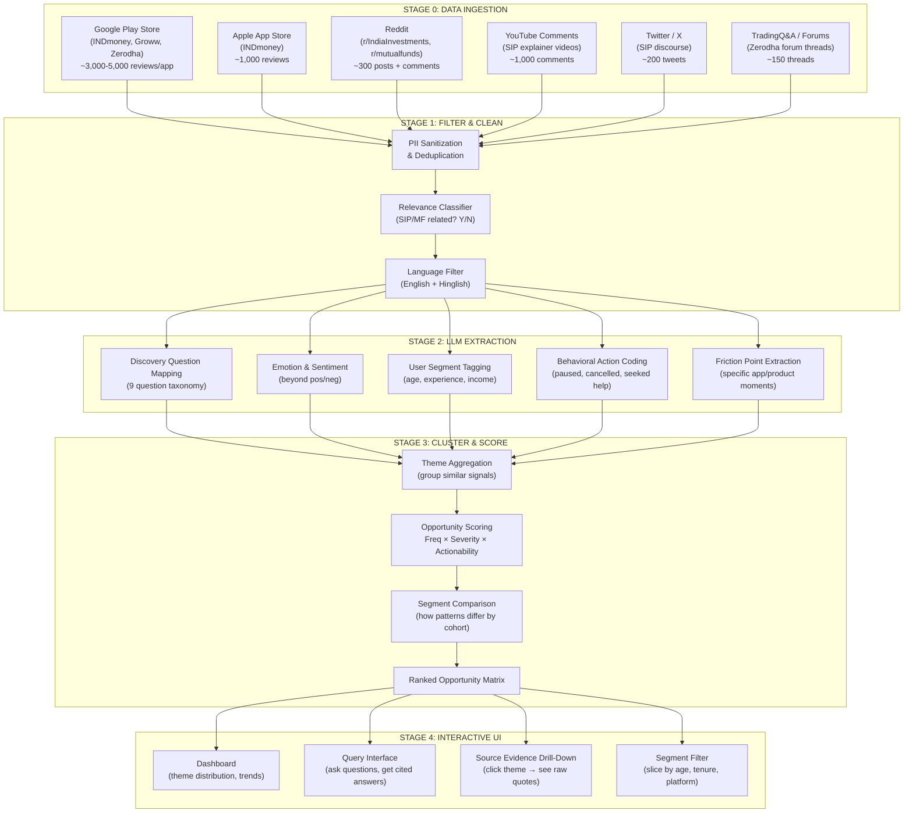
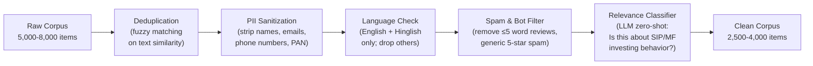
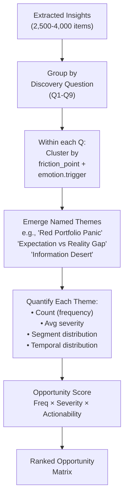
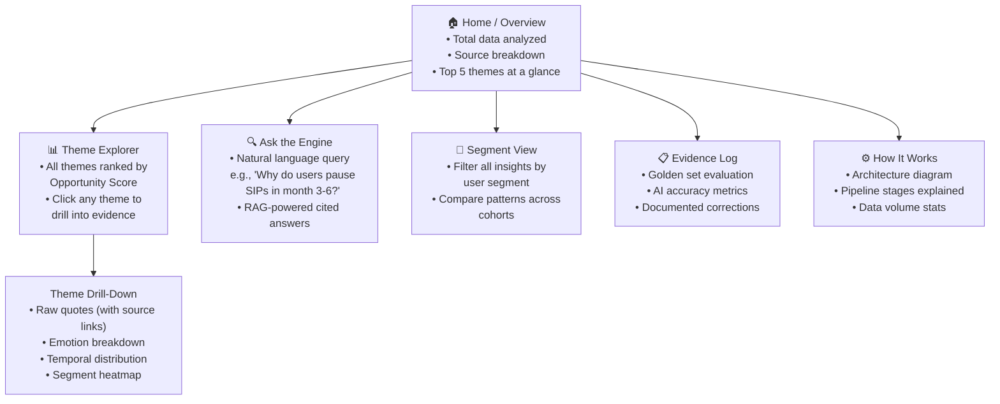
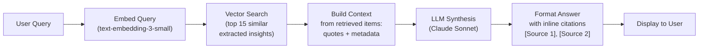

# 🔬 AI Discovery Engine — System Architecture

**Project:** INDmoney SIP Retention · **Product:** INDmoney  
**Engine Purpose:** Analyze 5,000+ public user signals to discover *why* first-time SIP investors drop off within 12 months — and surface the highest-impact opportunity areas for product intervention.

---

## Table of Contents

1. [Design Philosophy](#1-design-philosophy)
2. [High-Level System Architecture](#2-high-level-system-architecture)
3. [Stage 0 — Data Ingestion Layer](#3-stage-0--data-ingestion-layer)
4. [Stage 1 — Cleaning & Relevance Filtering](#4-stage-1--cleaning--relevance-filtering)
5. [Stage 2 — Multi-Dimensional LLM Extraction](#5-stage-2--multi-dimensional-llm-extraction)
6. [Stage 3 — Thematic Clustering & Opportunity Scoring](#6-stage-3--thematic-clustering--opportunity-scoring)
7. [Stage 4 — Interactive Query & Insights UI](#7-stage-4--interactive-query--insights-ui)
8. [Eval Layer — Golden Set & Evidence Log](#8-eval-layer--golden-set--evidence-log)
9. [Tech Stack & Deployment](#9-tech-stack--deployment)
10. [Data Schema Reference](#10-data-schema-reference)
11. [Prompt Engineering Appendix](#11-prompt-engineering-appendix)
12. [File & Folder Structure](#12-file--folder-structure)

---

## 1. Design Philosophy

The engine is designed around four principles drawn from the problem statement and the reference benchmark:

1. **Discovery, not just analysis.** The engine must uncover *unknown* user problems — not merely confirm what we suspect. It answers 9 specific discovery questions about SIP investor behavior and identifies patterns humans would miss across thousands of data points.

2. **Identify → Quantify → Compare.** The problem statement explicitly demands going beyond sentiment analysis. Every theme must be (a) identified with supporting evidence, (b) quantified by frequency and severity, and (c) compared against other opportunity areas to enable prioritization.

3. **Eval-gated trust.** Every AI-generated insight must be auditable. A hand-labeled golden set of 20 items benchmarks engine accuracy, and 2–3 explicit AI corrections demonstrate human oversight.

4. **Interactive and testable.** Mentors will test this via a live link. The UI must allow querying the engine's findings, drilling into source evidence, and exploring themes by segment — not just display static charts.

---

## 2. High-Level System Architecture

```
┌─────────────────────────────────────────────────────────────────────────────┐
│                        AI DISCOVERY ENGINE                                  │
│                                                                             │
│  ┌──────────┐    ┌──────────┐    ┌──────────────┐    ┌─────────────────┐   │
│  │ STAGE 0  │───▶│ STAGE 1  │───▶│   STAGE 2    │───▶│    STAGE 3      │   │
│  │ INGEST   │    │ FILTER   │    │   EXTRACT    │    │ CLUSTER & SCORE │   │
│  └──────────┘    └──────────┘    └──────────────┘    └────────┬────────┘   │
│                                                               │             │
│       ┌───────────────────────────────────────────────────────┘             │
│       ▼                                                                     │
│  ┌──────────────┐    ┌────────────────────────────────────────────────┐    │
│  │   STAGE 4    │    │            EVAL LAYER                          │    │
│  │ INTERACTIVE  │    │  Golden Set (20 items) + Accuracy Benchmarks   │    │
│  │  QUERY UI    │    │  + 2-3 Documented AI Corrections               │    │
│  └──────────────┘    └────────────────────────────────────────────────┘    │
└─────────────────────────────────────────────────────────────────────────────┘
```



---

## 3. Stage 0 — Data Ingestion Layer

### 3.1 Source Matrix

| # | Source | Target App / Community | Collection Method | Python Library / Tool | Target Volume | Key Data Fields |
|---|--------|----------------------|-------------------|----------------------|---------------|-----------------|
| 1 | **Google Play Store** | INDmoney (`com.indwealth`), Groww (`com.nextbillion.groww`), Zerodha (`com.zerodha.coin`) | API-based scraper | `google-play-scraper` | 3,000–5,000 per app | `userName`, `score` (1–5), `content`, `at` (date), `thumbsUpCount` |
| 2 | **Apple App Store** | INDmoney (`1459526006`) | RSS + scraper | `app-store-scraper` | 800–1,000 | `userName`, `rating`, `review`, `date` |
| 3 | **Reddit** | r/IndiaInvestments, r/mutualfunds, r/INDmoney | Reddit API | `praw` or `asyncpraw` | 200–300 posts + top comments | `title`, `selftext`, `score`, `comments`, `created_utc`, `subreddit` |
| 4 | **YouTube** | Comments on top 10–15 SIP explainer videos (Akshat Shrivastava, Ankur Warikoo, CA Rachana Ranade, Pranjal Kamra) | Comment downloader | `youtube-comment-downloader` or YouTube Data API v3 | 500–1,000 comments | `text`, `time`, `votes`, `video_id` |
| 5 | **Twitter / X** | Keyword search: "INDmoney SIP", "stopped SIP", "first SIP loss", "SIP paused" | Search API or manual | `snscrape` or manual export | 100–200 tweets | `content`, `date`, `likes`, `user_bio` |
| 6 | **TradingQ&A** | Zerodha forum SIP-related threads | Web scraping | `BeautifulSoup` + `requests` | 100–150 threads | `question`, `answer`, `votes`, `date` |

### 3.2 Ingestion Script Design

Each source gets its own scraper module under `scrapers/`. All output flows into a **unified schema**:

```python
# Unified ingestion schema — every source normalizes to this
{
    "id": "play_indmoney_00042",           # unique ID: {source}_{app}_{index}
    "source": "google_play",               # google_play | app_store | reddit | youtube | twitter | tradingqa
    "platform_app": "INDmoney",            # which app/community the data is about
    "text": "Started SIP 6 months ago...", # raw user text (review body / post / comment)
    "rating": 2,                           # numeric rating if available (1-5), null otherwise
    "date": "2025-03-14",                  # ISO date
    "engagement_score": 47,                # thumbsUp / upvotes / likes — proxy for resonance
    "url": "https://...",                  # link back to original source for citation
    "raw_metadata": { ... }                # source-specific fields preserved for audit
}
```

### 3.3 Search Keyword Strategy for Reddit / YouTube / Twitter

To ensure we capture SIP drop-off signals (not just generic investing chatter), we use a curated keyword matrix:

| Category | Search Terms |
|----------|-------------|
| **SIP Lifecycle** | `"started SIP"`, `"first SIP"`, `"SIP 6 months"`, `"SIP 1 year"`, `"SIP returns"`, `"SIP journey"` |
| **Drop-off Signals** | `"stopped SIP"`, `"paused SIP"`, `"cancelled SIP"`, `"SIP loss"`, `"SIP negative"`, `"SIP not working"` |
| **Emotional States** | `"SIP confused"`, `"SIP scared"`, `"SIP regret"`, `"SIP worth it"`, `"should I stop SIP"`, `"SIP market crash"` |
| **Platform-Specific** | `"INDmoney SIP"`, `"INDmoney mutual fund"`, `"Groww SIP"`, `"Zerodha Coin SIP"` |
| **Information Seeking** | `"SIP vs FD"`, `"SIP how long"`, `"SIP beginner"`, `"first time mutual fund"`, `"SIP advice"` |

### 3.4 Volume Targets & Quality Gate

| Metric | Target |
|--------|--------|
| Total raw data points ingested | **5,000–8,000** |
| After deduplication | **4,000–6,000** |
| After relevance filtering (Stage 1) | **2,500–4,000** |
| Sources represented | **≥ 5 distinct sources** |

---

## 4. Stage 1 — Cleaning & Relevance Filtering

### 4.1 Pipeline Steps



### 4.2 Relevance Classifier Prompt

```
You are a classifier for an investment product research project.

Given a user review, forum post, or comment, determine if it is RELEVANT 
to the experience of investing in SIPs (Systematic Investment Plans) or 
mutual funds in India.

RELEVANT means the text discusses ANY of the following:
- Starting, continuing, pausing, stopping, or thinking about a SIP
- Mutual fund investment experience (returns, NAV, XIRR, portfolio)
- Emotions or confusion related to investing (fear, uncertainty, regret, confidence)
- App experience related to investment tracking, mandates, auto-debit
- Seeking information or advice about SIP/mutual fund investing
- Comparing investment options (SIP vs FD, SIP vs stocks, etc.)

NOT RELEVANT means:
- Generic app bug reports unrelated to investing features
- Reviews about completely different features (loans, credit cards, US stocks only)
- Spam, gibberish, or content in non-English/non-Hindi languages
- Reviews that only say "good app" or "bad app" with zero investment context

Respond with ONLY a JSON object:
{
  "relevant": true/false,
  "confidence": 0.0-1.0,
  "reason": "one-line explanation"
}
```

### 4.3 PII Sanitization Rules

| PII Type | Detection Method | Action |
|----------|-----------------|--------|
| Email addresses | Regex: `[\w.-]+@[\w.-]+\.\w+` | Replace with `[EMAIL]` |
| Phone numbers | Regex: `\+?[\d\s-]{10,}` | Replace with `[PHONE]` |
| PAN numbers | Regex: `[A-Z]{5}\d{4}[A-Z]` | Replace with `[PAN]` |
| Account numbers | Regex: `\d{9,18}` (contextual) | Replace with `[ACCOUNT]` |
| Full names (if identifiable) | NER model or manual | Replace with `[USER]` |

---

## 5. Stage 2 — Multi-Dimensional LLM Extraction

This is the **core intelligence layer**. Each cleaned data point is processed through a structured LLM prompt that extracts multiple analytical dimensions simultaneously.

### 5.1 Extraction Dimensions

| Dimension | What It Captures | Why It Matters |
|-----------|-----------------|----------------|
| **Discovery Question Mapping** | Which of the 9 discovery questions this data point addresses | Directly answers the problem statement requirements |
| **Emotion Classification** | Goes beyond pos/neg: `anxious`, `confused`, `frustrated`, `disappointed`, `indifferent`, `reassured`, `confident`, `regretful` | Reveals *why* users feel what they feel — critical for root cause |
| **User Segment Signals** | Implicit clues about age, experience level, income stability, who influenced them | Enables segment-specific analysis (Part 2 & 3 of problem statement) |
| **Behavioral Action** | What the user *did* or *plans to do*: `continued`, `paused`, `cancelled`, `reduced amount`, `switched fund`, `uninstalled`, `asked someone`, `searched online` | Maps to actual drop-off behaviors |
| **Friction Point** | Specific product/app moment causing trouble: `portfolio screen`, `mandate setup`, `SIP date`, `returns display`, `customer support` | Pinpoints where in the product journey the breakdown happens |
| **Temporal Signal** | When in the SIP lifecycle this occurs: `first month`, `3-6 months`, `after 1 year`, `during market dip` | Identifies the critical windows for intervention |
| **Unmet Need** | What the user wishes existed but doesn't | Direct input into solution ideation |

### 5.2 Master Extraction Prompt

```
You are an expert product researcher analyzing user feedback about SIP 
(Systematic Investment Plan) and mutual fund investing on Indian platforms 
(INDmoney, Groww, Zerodha).

Analyze the following user text and extract structured insights.

USER TEXT:
"""
{text}
"""

SOURCE: {source}
RATING: {rating}
DATE: {date}

Extract the following as a JSON object:

{
  "discovery_questions": [
    // List which of these 9 questions this text provides evidence for:
    // Q1: Why do people start a SIP, and what do they expect?
    // Q2: What changes in behavior in months after starting?
    // Q3: What leads investors to pause, reduce, or stop a SIP?
    // Q4: What do investors check, and how often?
    // Q5: What confuses or worries them inside the app?
    // Q6: What do they do outside the app when unsure?
    // Q7: What separates continuers from drop-offs?
    // Q8: How do patterns differ across segments?
    // Q9: What unmet needs emerge consistently?
    // Return array of question numbers, e.g. ["Q3", "Q5", "Q9"]
  ],
  
  "emotion": {
    "primary": "anxious|confused|frustrated|disappointed|indifferent|reassured|confident|regretful|hopeful|angry",
    "intensity": "low|medium|high",
    "trigger": "brief description of what caused this emotion"
  },
  
  "user_segment": {
    "experience_level": "first_timer|beginner|intermediate|experienced|unknown",
    "age_hint": "student|early_career|mid_career|senior|unknown",
    "income_hint": "low|moderate|high|unknown",
    "influence_source": "peer|family|social_media|financial_advisor|self_research|unknown",
    "segment_evidence": "the exact phrase(s) that suggest this segment"
  },
  
  "behavioral_action": {
    "action_taken": "continued|paused|cancelled|reduced|increased|switched|uninstalled|contacted_support|searched_online|asked_someone|considering_stopping|none_mentioned",
    "action_reason": "brief reason for the action"
  },
  
  "friction_point": {
    "product_area": "portfolio_view|returns_display|sip_setup|mandate_payment|customer_support|notifications|educational_content|fund_selection|app_performance|none",
    "specific_issue": "brief description of the exact friction",
    "severity": "minor|moderate|critical"
  },
  
  "temporal_signal": {
    "sip_tenure": "pre_start|month_1|months_1_3|months_3_6|months_6_12|beyond_12|unknown",
    "market_context": "bull|bear|correction|volatile|stable|unknown"
  },
  
  "unmet_need": "description of what the user wishes existed, or null",
  
  "key_quote": "the most insightful verbatim phrase from the text (max 30 words)",
  
  "analysis_confidence": 0.0-1.0
}

RULES:
- If a dimension cannot be determined, use "unknown" or null
- key_quote must be EXACT text from the user, not paraphrased
- Do NOT infer investment advice preferences
- Focus on behavioral and emotional signals, not technical bugs
- If the text addresses multiple discovery questions, list ALL
```

### 5.3 Batching Strategy

To optimize API costs and stay within rate limits:

| Parameter | Value |
|-----------|-------|
| **Batch size** | 10 items per LLM call |
| **Model** | Claude 3.5 Haiku (for speed + cost on bulk) or GPT-4o-mini |
| **Fallback model** | Claude 3.5 Sonnet (for ambiguous/complex items flagged by Haiku) |
| **Estimated tokens per item** | ~300 input + ~400 output |
| **Total estimated API cost** | ~$8–15 for 4,000 items on Haiku |
| **Rate limiting** | 5 requests/second with exponential backoff |
| **Error handling** | Retry 3x, then log to `failed_extractions.json` for manual review |

### 5.4 Output Storage

All extracted data is stored in a structured JSON Lines file (`extracted_insights.jsonl`) where each line is one data point with all extraction dimensions attached. This becomes the engine's analytical database.

---

## 6. Stage 3 — Thematic Clustering & Opportunity Scoring

### 6.1 Theme Aggregation

After Stage 2, we have thousands of individually analyzed data points. Stage 3 aggregates them into **actionable themes**.



### 6.2 Opportunity Scoring Formula

Each theme receives a composite score:

$$\text{Opportunity Score} = \underbrace{W_f \cdot \text{Frequency}}_{\text{How often}} \times \underbrace{W_s \cdot \text{Severity}}_{\text{How painful}} \times \underbrace{W_a \cdot \text{Actionability}}_{\text{Can product fix it?}} \times \underbrace{W_r \cdot \text{Recency}}_{\text{Still happening?}}$$

| Factor | Definition | Scale | Weight |
|--------|-----------|-------|--------|
| **Frequency** | % of total relevant data points mentioning this theme | 0–1 (normalized) | $W_f = 0.30$ |
| **Severity** | Average `friction_point.severity` score (minor=1, moderate=2, critical=3) normalized | 0–1 | $W_s = 0.30$ |
| **Actionability** | Can this be addressed by a product change within INDmoney? (LLM-judged or manual) | 0–1 | $W_a = 0.25$ |
| **Recency** | Weighted toward data points from the last 12 months | 0–1 | $W_r = 0.15$ |

### 6.3 Expected Theme Categories

Based on preliminary research into INDmoney reviews and Indian investing forums, here are the likely emergent themes (to be validated by actual engine output):

| Theme ID | Theme Name | Discovery Questions | Expected Signal |
|----------|-----------|--------------------|-----------------| 
| T1 | **Red Portfolio Panic** | Q2, Q3, Q7 | First-time investors see negative returns and panic-pause without context |
| T2 | **Expectation vs. Reality Gap** | Q1, Q3, Q9 | Users expect visible growth in 3–6 months; reality of SIP compounding is years |
| T3 | **Information Desert** | Q4, Q5, Q6, Q9 | App shows raw numbers (XIRR, current vs invested) with no interpretation |
| T4 | **Mandate & Payment Friction** | Q3, Q5 | Auto-debit failures, bank bounce charges, missed SIP dates |
| T5 | **External Validation Seeking** | Q6, Q8 | Users leave app to check YouTube, Reddit, ask friends when unsure |
| T6 | **Over-Monitoring Anxiety** | Q2, Q4 | Checking portfolio daily; each micro-dip amplifies anxiety |
| T7 | **Peer Influence Dependency** | Q1, Q8 | Started because friend/influencer said to; no independent conviction |
| T8 | **Cross-Selling Fatigue** | Q5, Q9 | Aggressive prompts (credit cards, US stocks) erode trust in SIP experience |
| T9 | **Support Resolution Gap** | Q5 | SIP-related issues take days to resolve; bot-first support frustrates |

### 6.4 Segment Comparison Analysis

For each theme, the engine also computes how the signal differs across user segments:

```
Theme: "Red Portfolio Panic"
─────────────────────────────
By Experience Level:
  first_timer:    ████████████████████ 72%
  beginner:       ████████████ 48%
  intermediate:   ████ 15%
  experienced:    █ 3%

By SIP Tenure:
  months_1_3:     ████████████████ 62%
  months_3_6:     ██████████████████ 71%
  months_6_12:    ████████ 31%
  beyond_12:      ██ 8%

By Influence Source:
  social_media:   ████████████████████ 78%
  peer:           ████████████████ 65%
  self_research:  ████████ 32%
  financial_advisor: ██ 9%
```

---

## 7. Stage 4 — Interactive Query & Insights UI

### 7.1 UI Architecture

The discovery engine is deployed as a **Next.js web application** (or Streamlit app) with the following pages/views:



### 7.2 Page-by-Page Specification

#### Page 1: Home / Overview Dashboard
- **Header:** "AI Discovery Engine — INDmoney SIP Retention"
- **Stats bar:** Total data points analyzed | Sources covered | Themes identified | Date range
- **Top 5 themes** shown as cards with Opportunity Score, frequency count, and a representative quote
- **Source distribution** pie chart (Play Store, Reddit, YouTube, etc.)
- **Emotion heatmap** across all data

#### Page 2: Theme Explorer
- Sortable table of all themes with columns: Theme Name, Opportunity Score, Frequency, Severity, Top Segment Affected
- Click any row → opens Theme Drill-Down view
- Filter by discovery question (Q1–Q9)

#### Page 3: Theme Drill-Down (per theme)
- **Summary card:** Theme description, opportunity score breakdown
- **Evidence panel:** Scrollable list of 10–20 raw user quotes supporting this theme, each with:
  - Source badge (Play Store / Reddit / YouTube / etc.)
  - Date
  - Emotion tag
  - Segment tag
  - Clickable link to original source
- **Segment breakdown:** Bar chart showing theme prevalence by segment
- **Temporal breakdown:** Line chart showing when this theme peaks in the SIP lifecycle
- **Emotion breakdown:** Donut chart of emotions within this theme

#### Page 4: Ask the Engine (RAG Query Interface)
- Text input: "Ask a question about SIP investor behavior"
- RAG pipeline retrieves relevant extracted insights and synthesizes an answer
- Each answer includes **cited source quotes** (clickable)
- Example queries pre-loaded:
  - "Why do first-time investors pause SIPs in months 3–6?"
  - "What do users check when their portfolio is red?"
  - "How do social-media-influenced investors differ from self-researchers?"
  - "What unmet needs do first-time SIP investors express?"

#### Page 5: Segment View
- Dropdown filters: Experience Level, Age Hint, Influence Source, SIP Tenure
- Apply filters → all themes re-scored and re-ranked for that segment
- Side-by-side comparison: "First-timers vs. Experienced" or "Social-media-influenced vs. Self-researchers"

#### Page 6: How It Works
- Visual architecture diagram (the mermaid flowchart from Section 2)
- Step-by-step explanation of each stage
- Data volume at each stage (funnel visualization)
- Tooling and models used

#### Page 7: Evidence Log
- Golden set of 20 items: show human label vs. engine label side-by-side
- Agreement metrics: Overall accuracy, per-dimension accuracy
- 2–3 highlighted corrections with explanation

### 7.3 RAG Implementation for "Ask the Engine"



**Vector Store:** All `extracted_insights.jsonl` entries are embedded (using OpenAI `text-embedding-3-small` or Gemini embeddings) and stored in a lightweight vector index. Options:
- **In-memory:** `faiss` or `chromadb` (good for <10K items)
- **Cloud:** Pinecone free tier or Supabase pgvector

---

## 8. Eval Layer — Golden Set & Evidence Log

### 8.1 Golden Set Construction

1. **Random sample 20 data points** from the clean corpus (stratified across sources and rating levels)
2. **Human labels** (you, manually): For each item, fill in the same extraction schema from Stage 2
3. **Engine labels**: Run the same 20 items through the LLM extraction pipeline
4. **Compare**: Field-by-field accuracy measurement

### 8.2 Evaluation Metrics

| Dimension | Metric | Target |
|-----------|--------|--------|
| Discovery Question Mapping | Jaccard Similarity (set overlap of assigned Qs) | ≥ 0.75 |
| Emotion Classification | Exact match on `emotion.primary` | ≥ 80% |
| User Segment — Experience Level | Exact match | ≥ 75% |
| Behavioral Action | Exact match on `action_taken` | ≥ 80% |
| Friction Point — Product Area | Exact match | ≥ 70% |
| Temporal Signal — SIP Tenure | Exact match | ≥ 70% |
| Overall (all dimensions correct) | Strict match across all fields | ≥ 60% |

### 8.3 Documenting AI Corrections (2–3 Required)

Format for each correction in the Evidence Log:

```markdown
### Correction #1: Misclassified "Mandate Failure" as "Returns Disappointment"

**Data Point ID:** play_indmoney_01234
**Raw Text:** "My SIP payment failed twice because bank mandate expired. 
Now I have to set up everything again. Thinking of just stopping."

**AI Engine Classification:**
- Discovery Question: Q3 (What leads to pausing)  ✅
- Emotion: disappointed  ✅
- Friction Point: returns_display  ❌ (should be: mandate_payment)
- Behavioral Action: considering_stopping  ✅

**Why the AI Got It Wrong:**
The word "stopping" combined with negative sentiment caused the model to 
associate this with returns-related frustration. However, the actual root 
cause is a mandate/payment infrastructure issue, not investment performance.

**Corrected Label:** friction_point.product_area = "mandate_payment"

**Implication:** This correction reveals that the engine may be 
over-attributing drop-off intent to returns disappointment when 
payment infrastructure friction is the actual blocker. ~15% of 
"considering stopping" signals may actually be payment-related.
```

---

## 9. Tech Stack & Deployment

### 9.1 Recommended Stack

| Layer | Technology | Rationale |
|-------|-----------|-----------|
| **Scrapers** | Python 3.11+ with `google-play-scraper`, `app-store-scraper`, `praw`, `beautifulsoup4`, `youtube-comment-downloader` | Battle-tested libraries for each source |
| **Data Processing** | `pandas`, `json`, custom Python scripts | Simple, no over-engineering |
| **LLM Extraction** | Claude 3.5 Haiku API (bulk) + Claude 3.5 Sonnet (complex/fallback) | Best cost/quality ratio; strong at structured JSON output |
| **Embeddings** | OpenAI `text-embedding-3-small` or Google `text-embedding-004` | Fast, cheap, high quality for semantic search |
| **Vector Store** | ChromaDB (in-process) or Pinecone (free tier) | Simple setup; ChromaDB needs no external service |
| **Frontend** | Next.js 14 (App Router) + Tailwind CSS + shadcn/ui | Professional look, SSR for SEO, easy Vercel deploy |
| **Charts** | Recharts or Chart.js (via react-chartjs-2) | Clean, responsive data visualizations |
| **Backend API** | Next.js API Routes (serverless functions) | Co-located with frontend; zero DevOps |
| **Deployment** | Vercel (free tier) | One-click deploy from GitHub, HTTPS, public URL |
| **Data Storage** | JSON files in `/data` directory + ChromaDB persistence | No database setup needed; data fits in memory |

### 9.2 Alternative Stack (Faster to Build)

If speed is the priority over UI polish:

| Layer | Technology |
|-------|-----------|
| **Everything** | Python + Streamlit |
| **LLM** | Claude API via `anthropic` SDK |
| **Vector Store** | ChromaDB |
| **Deployment** | Streamlit Community Cloud (free) |
| **Build time** | ~1–2 days vs. ~2–3 days for Next.js |

### 9.3 Deployment Checklist

- [ ] Public URL accessible without login
- [ ] HTTPS enabled (automatic on Vercel/Streamlit Cloud)
- [ ] No API keys exposed in client-side code
- [ ] Environment variables configured for LLM API keys
- [ ] Error handling for API rate limits
- [ ] Loading states for LLM-powered queries
- [ ] Mobile-responsive layout (mentors may test on phone)

---

## 10. Data Schema Reference

### 10.1 Raw Ingested Data (`raw_data.jsonl`)

```json
{
  "id": "play_indmoney_00042",
  "source": "google_play",
  "platform_app": "INDmoney",
  "text": "I started my first SIP 4 months ago...",
  "rating": 2,
  "date": "2025-03-14",
  "engagement_score": 47,
  "url": "https://play.google.com/...",
  "raw_metadata": {}
}
```

### 10.2 Filtered Data (`filtered_data.jsonl`)

Same schema as raw, plus:
```json
{
  "...all raw fields...",
  "relevance": {
    "relevant": true,
    "confidence": 0.92,
    "reason": "Discusses SIP pause due to negative returns"
  },
  "cleaned_text": "I started my first SIP 4 months ago..."
}
```

### 10.3 Extracted Insights (`extracted_insights.jsonl`)

Same schema as filtered, plus all Stage 2 extraction dimensions:
```json
{
  "...all filtered fields...",
  "discovery_questions": ["Q2", "Q3", "Q5"],
  "emotion": { "primary": "anxious", "intensity": "high", "trigger": "portfolio showing -4%" },
  "user_segment": { "experience_level": "first_timer", "age_hint": "early_career", "...": "..." },
  "behavioral_action": { "action_taken": "considering_stopping", "action_reason": "negative returns" },
  "friction_point": { "product_area": "returns_display", "specific_issue": "only shows red number", "severity": "critical" },
  "temporal_signal": { "sip_tenure": "months_3_6", "market_context": "correction" },
  "unmet_need": "Want to know if this level of loss is normal for a 4-month SIP",
  "key_quote": "I don't know if -4% is bad or normal for a new SIP",
  "analysis_confidence": 0.88
}
```

### 10.4 Theme Aggregation (`themes.json`)

```json
{
  "theme_id": "T1",
  "theme_name": "Red Portfolio Panic",
  "description": "First-time investors see negative returns and panic-pause without understanding that short-term dips are normal for SIPs",
  "discovery_questions": ["Q2", "Q3", "Q7"],
  "opportunity_score": 0.87,
  "score_breakdown": {
    "frequency": 0.72,
    "severity": 0.91,
    "actionability": 0.85,
    "recency": 0.80
  },
  "data_point_count": 847,
  "percentage_of_corpus": "33.8%",
  "top_segments": ["first_timer", "early_career", "social_media_influenced"],
  "peak_tenure": "months_3_6",
  "representative_quotes": [ "...", "...", "..." ],
  "supporting_data_point_ids": ["play_indmoney_00042", "reddit_indiainv_00108", "..."]
}
```

---

## 11. Prompt Engineering Appendix

### 11.1 Relevance Filter Prompt
See [Section 4.2](#42-relevance-classifier-prompt) above.

### 11.2 Master Extraction Prompt
See [Section 5.2](#52-master-extraction-prompt) above.

### 11.3 RAG Synthesis Prompt (for "Ask the Engine")

```
You are the AI Discovery Engine for an INDmoney SIP retention research project. 
You have analyzed {total_data_points} user reviews, forum posts, and social media 
discussions about SIP and mutual fund investing in India.

A researcher is asking you a question. Answer it using ONLY the evidence from 
the retrieved data points below. Do NOT use general knowledge about investing.

RETRIEVED EVIDENCE:
{context_with_citations}

RESEARCHER QUESTION: {query}

INSTRUCTIONS:
1. Synthesize an answer grounded ENTIRELY in the evidence provided
2. Cite sources inline using [Source N] notation
3. Quantify where possible ("X out of Y data points mention...")
4. Highlight segment differences if the evidence shows them
5. Note any contradictions or surprising patterns in the data
6. If the evidence is insufficient to answer, say so explicitly
7. Do NOT provide investment advice or fund recommendations
8. Keep the answer focused and analytical (200-400 words)
```

### 11.4 Theme Naming Prompt

```
Given the following cluster of {n} user feedback data points about SIP/mutual 
fund investing, all sharing similar themes:

CLUSTER SUMMARY:
- Top discovery questions: {questions}
- Dominant emotions: {emotions}
- Common friction points: {frictions}
- Common behavioral actions: {actions}
- Representative quotes: {quotes}

Generate:
1. A concise, memorable theme name (3-5 words, e.g., "Red Portfolio Panic")
2. A one-paragraph description of what this theme captures
3. The key insight this theme reveals about SIP investor behavior

Format as JSON:
{
  "theme_name": "...",
  "description": "...",
  "key_insight": "..."
}
```

---

## 12. File & Folder Structure

```
discovery-engine/
├── README.md                          # Project overview and setup instructions
├── architecture.md                    # This document
├── .env.example                       # Template for API keys
├── .gitignore
├── package.json                       # (if Next.js)
├── requirements.txt                   # (if Python/Streamlit)
│
├── scrapers/                          # Stage 0: Data collection
│   ├── play_store_scraper.py          # Google Play Store reviews
│   ├── app_store_scraper.py           # Apple App Store reviews
│   ├── reddit_scraper.py              # Reddit posts and comments
│   ├── youtube_scraper.py             # YouTube comment extraction
│   ├── twitter_scraper.py             # Twitter/X search results
│   ├── tradingqa_scraper.py           # TradingQ&A forum threads
│   └── run_all_scrapers.py            # Orchestrator: runs all, merges output
│
├── pipeline/                          # Stage 1-3: Processing pipeline
│   ├── stage1_filter.py               # Dedup, PII, relevance filtering
│   ├── stage2_extract.py              # LLM extraction (master prompt)
│   ├── stage3_cluster.py              # Theme clustering & opportunity scoring
│   ├── prompts/                       # All LLM prompts as text files
│   │   ├── relevance_filter.txt
│   │   ├── master_extraction.txt
│   │   ├── theme_naming.txt
│   │   └── rag_synthesis.txt
│   └── utils/
│       ├── llm_client.py              # Unified Claude/GPT API wrapper
│       ├── embeddings.py              # Embedding generation
│       └── scoring.py                 # Opportunity score calculator
│
├── data/                              # All data artifacts
│   ├── raw/                           # Stage 0 output
│   │   ├── play_store_indmoney.jsonl
│   │   ├── play_store_groww.jsonl
│   │   ├── play_store_zerodha.jsonl
│   │   ├── app_store_indmoney.jsonl
│   │   ├── reddit_posts.jsonl
│   │   ├── youtube_comments.jsonl
│   │   ├── twitter_results.jsonl
│   │   └── tradingqa_threads.jsonl
│   ├── filtered/                      # Stage 1 output
│   │   └── filtered_data.jsonl
│   ├── extracted/                     # Stage 2 output
│   │   └── extracted_insights.jsonl
│   ├── themes/                        # Stage 3 output
│   │   ├── themes.json
│   │   └── opportunity_matrix.json
│   └── eval/                          # Evidence log data
│       ├── golden_set_human.json      # 20 hand-labeled items
│       ├── golden_set_engine.json     # Engine labels for same 20
│       ├── eval_results.json          # Comparison metrics
│       └── corrections.md            # 2-3 documented AI corrections
│
├── app/                               # Stage 4: Next.js frontend (or Streamlit)
│   ├── page.tsx                       # Home / Overview
│   ├── themes/
│   │   ├── page.tsx                   # Theme Explorer
│   │   └── [id]/page.tsx             # Theme Drill-Down
│   ├── ask/
│   │   └── page.tsx                   # RAG Query Interface
│   ├── segments/
│   │   └── page.tsx                   # Segment View
│   ├── how-it-works/
│   │   └── page.tsx                   # Architecture explainer
│   ├── evidence/
│   │   └── page.tsx                   # Evidence Log viewer
│   ├── api/                           # API routes
│   │   ├── query/route.ts             # RAG endpoint
│   │   ├── themes/route.ts            # Theme data endpoint
│   │   └── segments/route.ts          # Segment filter endpoint
│   └── components/
│       ├── ThemeCard.tsx
│       ├── QuoteCard.tsx
│       ├── OpportunityMatrix.tsx
│       ├── SegmentChart.tsx
│       ├── EmotionHeatmap.tsx
│       └── SourceBadge.tsx
│
└── docs/
    └── evidence_log.md                # Final evidence log for submission
```

---

> **Next Steps:** With this architecture defined, the implementation order is:
> 1. Set up project skeleton and environment
> 2. Build and run scrapers (Stage 0)
> 3. Implement filtering pipeline (Stage 1)
> 4. Build LLM extraction pipeline (Stage 2)
> 5. Implement clustering and scoring (Stage 3)
> 6. Build the interactive UI (Stage 4)
> 7. Construct golden set and evidence log (Eval Layer)
> 8. Deploy to Vercel / Streamlit Cloud

