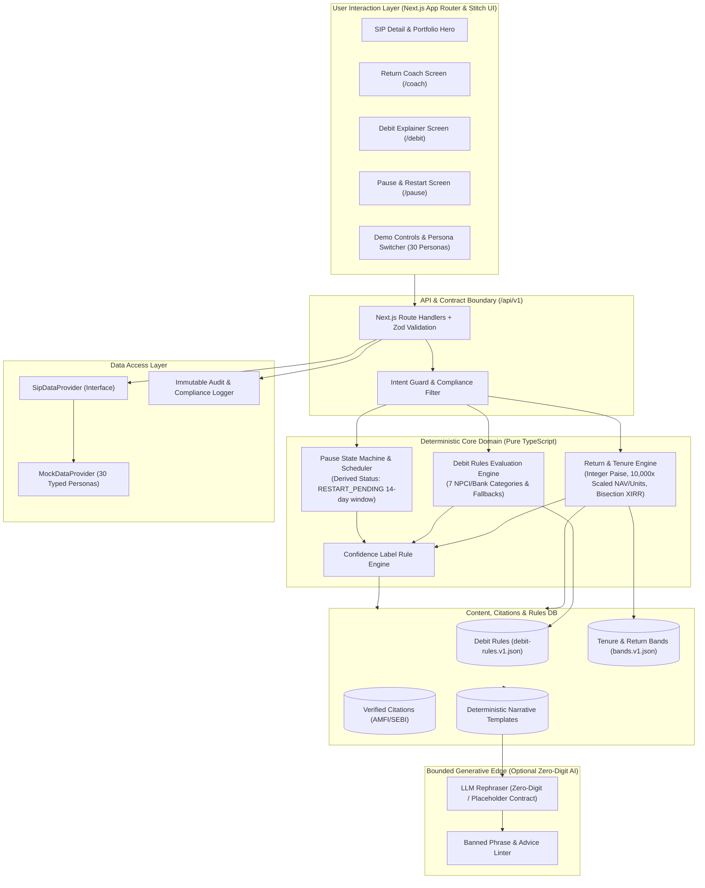
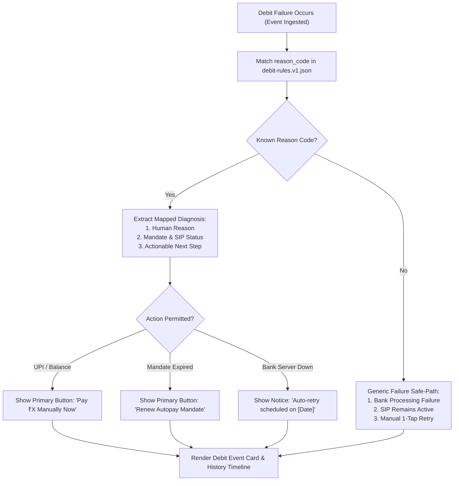
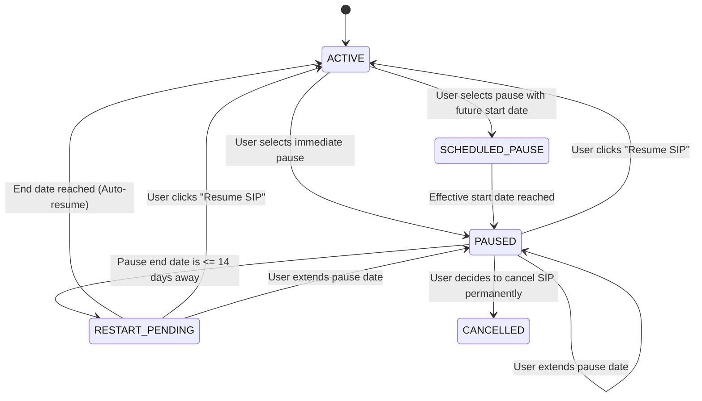
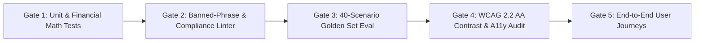

# Architecture Specification: SIP Steady MVP

**Document Version:** 2.0.0 (Updated post Stitch Design & Research Integration)  
**Project:** INDmoney SIP Steady MVP (Graduation Project Nextleap)  
**Status:** Approved for Implementation  
**Inputs & References:** [problem-statement.md](../../problem-statement.md), [design-system.md](../../design-system.md), [research-context.md](../../research-context.md), [edge-case.md](edge-case.md), Stitch Design System & Screens (`stitch_indmoney_sip_confidence_experience/`).

---

## 1. Executive Summary & Problem-to-Architecture Mapping

### 1.1 Core Problem Statement & Research Foundation
Research synthesized across 26 surveyed investors (N=26, with N=21 sensitivity view and INDmoney n=11 cohort), 6 deep-dive user interview records (P00–P05; noting P00 is researcher-context only and P05 is a Groww comparison case), and 3,079 public review signals from the AI Discovery Engine demonstrates:
> *"Investors can see what happened to their SIP, but not what it means or what to do next."*

The primary retention breakdown occurs in **three distinct operational and psychological failure modes**:
1. **Return Anxiety & Metric Confusion (Months 3–6):** Early sideways or negative returns and obscure metrics (`XIRR`, `Absolute Return`, `NAV`) trigger second-guessing. 13/26 survey respondents were unsure or confused by returns, 16/26 rated confidence 1–3 out of 5, and 9/26 chose "clearer return or volatility explanations" as the single most valuable improvement.
2. **Debit & Mandate Friction:** Auto-debit failures (11/26 respondents; 4/11 rating clarity 1–2 of 5) display cryptic bank error codes without clarifying whether the underlying SIP is still active, whether a penalty applies, or what single action recovers it.
3. **Cash-Flow Shocks & Permanent Pausing:** When sudden income drops or unexpected expenses arise (15/26 sized by monthly affordability; 4/26 had a cash-flow shock), investors pause their SIP. As documented in interview P02, mandate ambiguity and the absence of a calm, scheduled restart reminder turn temporary pauses into permanent lapses.

### 1.2 The Architectural Solution: SIP Steady
To drive the **12-Month Active SIP Retention Rate** (North Star Metric), the architecture delivers three tightly coupled, high-trust modules:
- **Module 1: Return Coach** — Contextualizes performance at the user's exact tenure stage (e.g. Month 5) using calm, descriptive explanations and verified citations (AMFI, SEBI, historical studies). It strictly refuses to provide financial advice.
- **Module 2: Rules-Based Debit Explainer** — A deterministic triage engine that converts raw bank/NPCI error codes into three structured answers: *Why it failed*, *Is my SIP still active?*, and *What to do next*.
- **Module 3: Pause & Restart Controls** — Transparent side-by-side comparison of *Pause vs. Reduce vs. Cancel*, with an explicit resume date picker and opt-in, non-urgent restart reminders.



---

## 2. Core Architectural Principles

1. **Deterministic Core, Generative Edge:**  
   Every calculation, tenure classification, failure diagnosis, state transition, and confidence rating is computed deterministically in pure, audited TypeScript. Generative AI is strictly restricted to editorial rephrasing of pre-approved templates and can be disabled with zero impact on functionality.
2. **Zero-Digit Generation Contract:**  
   The LLM is **never allowed to generate numbers, percentages, currency amounts, dates, or fees**. The deterministic core injects tokenized placeholders (e.g. `{{invested}}`, `{{current_value}}`, `{{tenure_months}}`). Any LLM output containing numeric digits (`/\d/`) or malformed tokens is discarded, falling back instantly to the deterministic template.
3. **Calm-by-Default Psychology (Stitch & Design System Conformance):**  
   - Flat and negative returns **never use alarm red/coral colors**. Negative returns are displayed in neutral slate text to avoid panicking users during normal market corrections.
   - Coral (`#EB5B3C` / light text `#C2410C` / dark text `#F4806A`) is reserved exclusively for true technical failures (e.g. mandate rejection, debit failure).
   - Zero FOMO, zero countdown timers, zero streak-loss pressure, and zero urgency prompts.
4. **Strict Compliance & Advice Refusal:**  
   The system never suggests buying, selling, pausing, or continuing a fund. Every Coach view carries a visible, persistent disclaimer: *"Explains your SIP figures. Not investment advice."* Advice-seeking inputs trigger a deterministic refusal with verified educational links.
5. **Pluggable Data Architecture & Scaled Precision:**  
   All data consumption is abstracted behind a `SipDataProvider` interface. The MVP executes against 30 self-contained mock fixtures representing key research personas and edge scenarios. All currency is held in **integer paise** and all NAV/units in **integers scaled by 10,000**, guaranteeing zero floating-point arithmetic drift.
6. **Derived State Rule:**  
   SIP status is **strictly derived, never stored directly as mutable state**. It is dynamically computed from settled instalments, active pause schedules, and bank mandate status. Specifically, a paused SIP whose restart date is $\le 14$ days away automatically evaluates to `RESTART_PENDING`.

---

## 3. Technology Stack Specification

| Tier | Technology | Specification / Version | Justification |
| :--- | :--- | :--- | :--- |
| **Framework** | Next.js | `16.4.5` (App Router, Turbopack) | Modernized production baseline with zero security vulnerabilities (Decision D-02). |
| **Runtime & Language** | Node.js 22+ & TypeScript | `5.6+` (Strict Mode) | Maximum type safety across domain engines, contracts, and frontend views. |
| **UI Library** | React | `19.x` | Modern React Server Components and concurrent rendering. |
| **Styling** | Tailwind CSS | `3.4+` | CSS Variable tokens derived from INDmoney Design System and Stitch (`canvas`, `surface-1`, etc.). |
| **Icons & Typography** | Lucide React & Material Symbols | `latest` / Inter & JetBrains Mono | Stitch UI parity: clean icons and mandatory `tabular-nums` for all financial metrics. |
| **Validation** | Zod | `3.23+` / `4.x` | Runtime validation for all API inputs, outputs, and JSON rule definitions. |
| **Linter & Toolchain** | ESLint | `9.x` (Flat Config: `eslint.config.mjs`) | Modernized linter replacing deprecated `next lint`. |
| **Financial Math** | Decimal.js / Integer Arithmetic | `latest` | Exact integer paise arithmetic, $10^4$ unit scaling, and Decimal.js bisection XIRR solver. |
| **Testing** | Vitest & Playwright | Vitest `5.x`, Playwright `latest` | High-speed unit tests for domain logic + end-to-end user journey validation. |

---

## 4. System Components & Module Architecture

### 4.1 Module 1: Return Coach

The Return Coach resolves user confusion regarding flat or negative returns in early tenure without crossing into investment advice.

```
                          ┌────────────────────────┐
                          │   POST /coach Request  │
                          └───────────┬────────────┘
                                      │
                         ┌────────────▼─────────────┐
                         │   Deterministic Intent   │
                         │     Guard & Filter       │
                         └────────────┬─────────────┘
                      Advice / Toxic  │   Valid In-Scope
                  ┌───────────────────┴───────────────────┐
                  ▼                                       ▼
       ┌──────────────────────┐              ┌───────────────────────────┐
       │ Fixed Refusal Block  │              │ Domain Returns Calculator │
       │  (Static Template)   │              │ (Paise, 10k Scaled Units) │
       └──────────────────────┘              └─────────────┬─────────────┘
                                                           │
                                             ┌─────────────▼─────────────┐
                                             │  Tenure & Situation Band  │
                                             │     Classifier (v1)       │
                                             └─────────────┬─────────────┘
                                                           │
                                             ┌─────────────▼─────────────┐
                                             │ Passage & Source Selector │
                                             │   (AMFI / SEBI Library)   │
                                             └─────────────┬─────────────┘
                                                           │
                                             ┌─────────────▼─────────────┐
                                             │ Deterministic Template    │
                                             │ Assembly (3 Core Blocks)  │
                                             └─────────────┬─────────────┘
                                                           │
                                      ┌────────────────────┴────────────────────┐
                           LLM Mode   │                             Template    │
                                      ▼                                         ▼
                           ┌─────────────────────┐                   ┌─────────────────────┐
                           │   LLM Rephraser     │                   │ Format & Substitute │
                           │  (Zero-Digit / Zod) │                   │  Integer Placeholders│
                           └──────────┬──────────┘                   └──────────┬──────────┘
                                      │                                         │
                             Pass     │ Fail (Fallback)                         │
                         ┌────────────┴─────────────┐                           │
                         ▼                          ▼                           │
             ┌──────────────────────┐   ┌──────────────────────┐                │
             │ Format & Substitute  │   │ Format & Substitute  │                │
             │ Placeholders         │   │ (Deterministic Base) │                │
             └──────────┬───────────┘   └──────────┬───────────┘                │
                        │                          │                            │
                        └──────────────────────────┼────────────────────────────┘
                                                   ▼
                                      ┌────────────────────────┐
                                      │ Complete API Response  │
                                      │ + Audit Log Entry      │
                                      └────────────────────────┘
```

#### Core Execution Steps:
1. **Financial Computations:**
   - **Invested Amount ($I$):** Sum of all *successful* instalments in integer paise (`CurrencyPaise`).
   - **Units & NAV:** Held in integer form scaled by $10^4$ (`units_scaled`, `nav_scaled`).
   - **Current Value ($V$):** `Math.round((units_scaled * nav_scaled) / 1000000)` in integer paise.
   - **Absolute Return:** $A = V - I$; Percentage: $A\% = \frac{V - I}{I} \times 100$.
   - **XIRR Computation:** Bracketed bisection method solving $\sum \frac{C_i}{(1+r)^{(d_i - d_0)/365}} = 0$. If tenure $< 12$ months, XIRR carries an explicit disclaimer explaining that annualized short-term figures can appear unnaturally volatile.
2. **Tenure & Situation Classification:**
   - Maps user tenure into bands: `M1` (<1 mo), `M1_3` (1–3 mo), `M3_6` (3–6 mo), `M6_12` (6–12 mo), `OVER_12` (>12 mo).
   - Maps return performance into categories: `FLAT` ($|A\%| \le 0.5\%$), `SMALL_NEGATIVE` ($-0.5\% > A\% \ge -5.0\%$), `NEGATIVE` ($A\% < -5.0\%$), `SMALL_POSITIVE` ($0.5\% < A\% \le 5.0\%$), `POSITIVE` ($A\% > 5.0\%$).
3. **Structured Explanation Construction:**  
   Every explanation is deterministically assembled into three mandated blocks matching Stitch UI:
   - **Block 1: Your Figures:** Exact invested amount, current value, total instalments, and net change in tabular numerals.
   - **Block 2: What This Means at Month N:** Plain-language interpretation contextualizing why equity volatility in early months is standard and highlighting the benefits of rupee-cost averaging.
   - **Block 3: What It Does NOT Mean:** Reassurance that early paper dips do not mean the fund has failed or that future compounding is broken.
4. **Citation & Confidence Scoring:**  
   Attaches vetted source metadata (e.g. AMFI educational publications, SEBI investor guidelines). Confidence score (`HIGH`, `MEDIUM`, `LOW`) is computed from input completeness and rule match quality.

---

### 4.2 Module 2: Rules-Based Debit Explainer

The Debit Explainer transforms cryptic bank/autopay rejections into transparent, actionable guidance without any LLM hallucination risk.

#### Decision Flow & Rules Matrix:



#### Deterministic Error Code Matrix (`debit-rules.v1.json` - 7 Categories):

| Error Code Category | Human Reason Description | SIP Status Impact | Next Best Action | Retry Allowed |
| :--- | :--- | :--- | :--- | :--- |
| `UPI_DAILY_LIMIT` | Your bank's UPI daily transaction limit was reached on the debit date. | **ACTIVE · 1 failed instalment** (SIP not cancelled) | "Pay ₹X manually now" or wait for next debit | Yes (Immediate) |
| `INSUFFICIENT_FUNDS` | Account balance was insufficient at the scheduled debit time. | **ACTIVE · 1 failed instalment** (Mandate remains active) | "Add funds to bank account and retry" | Yes (Immediate) |
| `BANK_UNAVAILABLE` | Your bank core banking servers did not respond during debit processing. | **ACTIVE · 1 failed instalment** (Technical failure) | "Automated retry scheduled in 24 hours" | No (Auto-managed) |
| `MANDATE_EXPIRED` | The e-mandate registration period has concluded. | **ATTENTION REQUIRED** (Future debits paused) | "Re-authorize UPI Autopay in 2 minutes" | Yes (Mandate Flow) |
| `MANDATE_REJECTED` | The mandate was revoked or rejected by the issuing bank. | **CANCELLED BY BANK** | "Set up a new Autopay mandate" | Yes (New Setup) |
| `NETWORK_TIMEOUT` | NPCI / UPI gateway connection timed out during clearing. | **ACTIVE · 1 failed instalment** (Temporary glitch) | "Retry payment now" | Yes (Immediate) |
| `GENERIC_UNKNOWN` | We could not confirm the exact bank failure code. | **ACTIVE · 1 failed instalment** (Safe default) | "Retry payment or contact support" | Yes (Immediate) |

---

### 4.3 Module 3: Pause & Restart Controls

The Pause & Restart module protects investors facing cash-flow shocks from permanent drop-off by making pause transparent and providing structured, opt-in reactivation.

#### 1. Options Comparison Framework (Stitch Parity)
Before initiating a pause, the UI presents three equally weighted, non-judgmental choices:
- **Pause SIP:** Temporarily halts upcoming debits. The bank mandate stays registered; no penalties are charged; resume anytime.
- **Reduce Amount (Step-Down):** Lowers the monthly instalment (e.g. from ₹5,000 to ₹1,000) to maintain continuity without financial strain.
- **Cancel SIP:** Completely revokes the bank mandate and stops all future instalments. Existing units remain invested and continue to compound.

#### 2. Pause State Machine with 14-Day `RESTART_PENDING` Window



#### 3. Opt-in Non-Urgent Reminder Architecture
- When pausing, users can opt into a calm restart reminder (default: Off).
- Reminders require an explicit target date (e.g. 1 month, 3 months, or custom date).
- **Communication Tone Rule:** Reminders must state only factual status: *"Your SIP for [Fund Name] was scheduled to resume on [Date]. Would you like to resume, extend the pause, or keep it paused?"*
- Banned from reminders: Guilt language, missed compounding warnings, streak loss alerts, or countdowns.

---

## 5. Bounded Generative Edge & Compliance Safeguards

To maintain SEBI non-advice compliance and eliminate hallucination risks, generative AI is subjected to a strict containment pipeline:

```
┌────────────────────────────────────────────────────────────────────────┐
│                        Generative Edge Boundary                        │
│                                                                        │
│   Fact Object (Deterministic)                                          │
│   ┌──────────────────────────────────────────────────────────────┐     │
│   │ • invested: "{{invested}}"          • stage: "M3_6"          │     │
│   │ • current_val: "{{current_val}}"    • status: "ACTIVE"       │     │
│   │ • template_text: "In month 5..."    • approved_passages: []  │     │
│   └──────────────────────────────┬───────────────────────────────┘     │
│                                  │                                     │
│                                  ▼                                     │
│                     ┌─────────────────────────┐                        │
│                     │ System Prompt & Schema  │                        │
│                     │ (Zero-Digit Directive)  │                        │
│                     └────────────┬────────────┘                        │
│                                  │                                     │
│                                  ▼                                     │
│                     ┌─────────────────────────┐                        │
│                     │ LLM Completion Service  │                        │
│                     └────────────┬────────────┘                        │
│                                  │                                     │
│                                  ▼                                     │
│   Strict Validation Gate (Code Evaluated)                              │
│   ┌──────────────────────────────────────────────────────────────┐     │
│   │ 1. Zero Digits Check: Reject if /\d/ matches outside tokens  │     │
│   │ 2. Placeholder Integrity: All {{tokens}} present & unchanged │     │
│   │ 3. Banned Phrase Linter: No advice/urgency/pressure words    │     │
│   │ 4. Entity Whitelist: No unapproved AMCs or stock tickers     │     │
│   └──────────────────────────────┬───────────────────────────────┘     │
│                                  │                                     │
│                    ┌─────────────┴─────────────┐                       │
│              Pass  │                           │  Fail                 │
│                    ▼                           ▼                       │
│       ┌─────────────────────────┐ ┌─────────────────────────┐         │
│       │ Substitute Real Figures │ │ Revert to Deterministic │         │
│       │ into Placeholder Tokens │ │ Template Instantly      │         │
│       └─────────────────────────┘ └─────────────────────────┘         │
└────────────────────────────────────────────────────────────────────────┘
```

### Banned-Phrase & Advice Linter Rules (`src/lib/banned-phrases.ts`)
The post-generation validator evaluates text against strict regular expression blacklists:
- **Imperatives to Act:** `should buy`, `must sell`, `recommend stopping`, `stay invested`, `exit now`, `switch to`.
- **Urgency & Pressure:** `act fast`, `hurry`, `don't miss out`, `limited time`, `streak broken`.
- **Return Predictions:** `will recover by`, `guaranteed return`, `expected to gain`, `target price`.

If any violation occurs, the generation is rejected and logged, and the user receives the deterministic pre-vetted template.

---

## 6. Domain Data Model & Entity Specifications

All monetary values are modeled in **integer paise** (1 INR = 100 paise), and NAV and units are stored in integer form scaled by 10,000 to eliminate floating-point representation bugs.

```typescript
// Core Domain Entities (TypeScript / Zod Specs)

export type CurrencyPaise = number; // Integer: ₹5,000 = 500000
export type ScaledNumber = number;   // Integer: 65.8700 = 658700 (scaled by 10,000)

export type SipStatus = 'ACTIVE' | 'ACTIVE_WITH_ALERT' | 'PAUSED' | 'RESTART_PENDING' | 'CANCELLED' | 'COMPLETED';
export type InstalmentStatus = 'SUCCESS' | 'FAILED' | 'PENDING' | 'SKIPPED';
export type TenureStage = 'M1' | 'M1_3' | 'M3_6' | 'M6_12' | 'OVER_12';
export type ReturnSituation = 'FLAT' | 'SMALL_NEGATIVE' | 'NEGATIVE' | 'SMALL_POSITIVE' | 'POSITIVE' | 'INSUFFICIENT_DATA';
export type ConfidenceLevel = 'HIGH' | 'MEDIUM' | 'LOW';

export interface SipAccount {
  id: string;
  userId: string;
  schemeName: string;
  category: 'EQUITY_LARGE_CAP' | 'EQUITY_FLEXI_CAP' | 'EQUITY_SMALL_CAP' | 'HYBRID' | 'DEBT';
  frequency: 'MONTHLY' | 'WEEKLY' | 'DAILY';
  instalmentAmountPaise: CurrencyPaise;
  startDate: string; // ISO 8601 (YYYY-MM-DD)
  dayOfMonth: number; // e.g. 15
  mandateType: 'UPI_AUTOPAY' | 'NETBANKING_ENACH';
  mandateStatus: 'ACTIVE' | 'PENDING' | 'EXPIRED' | 'REJECTED';
}

export interface Instalment {
  id: string;
  sipId: string;
  dueDate: string; // ISO 8601
  amountPaise: CurrencyPaise;
  navScaled: ScaledNumber; // NAV * 10,000
  unitsScaled: ScaledNumber; // Units * 10,000
  status: InstalmentStatus;
  settledAt?: string;
  failureReasonCode?: string;
}

export interface ValuationSnapshot {
  sipId: string;
  asOfDate: string;
  currentNavScaled: ScaledNumber;
  totalUnitsScaled: ScaledNumber;
  investedPaise: CurrencyPaise;
  currentValuePaise: CurrencyPaise;
  absoluteReturnPaise: CurrencyPaise;
  absoluteReturnPct: number; // e.g. -1.82
  providerXirrBps?: number; // Basis points (1250 bps = 12.50%)
  calculatedXirrBps?: number;
}

export interface DebitEvent {
  id: string;
  sipId: string;
  instalmentId: string;
  occurredAt: string;
  amountPaise: CurrencyPaise;
  reasonCode: string;
  providerRawMessage?: string;
  humanReason: string;
  sipStatusAfterFailure: SipStatus;
  nextActionText: string;
  manualRetryAllowed: boolean;
  autoRetryScheduled: boolean;
  nextScheduledRetryDate?: string;
  resolved: boolean;
}

export interface PauseRecord {
  id: string;
  sipId: string;
  requestedAt: string;
  pauseStartDate: string;
  pauseEndDate?: string; // null indicates indefinite pause
  resumeDate?: string;
  status: 'SCHEDULED' | 'ACTIVE' | 'RESUMED' | 'CANCELLED';
  optInReminder: boolean;
  reminderScheduledDate?: string;
}

export interface VerifiedSource {
  id: string;
  publisher: 'AMFI' | 'SEBI' | 'CRISIL' | 'RESERVE_BANK_OF_INDIA';
  title: string;
  url: string;
  publishedDate: string;
  verifiedDate: string;
  citationSnippet: string;
}
```

---

## 7. Frontend UI Architecture & Stitch Screen Mapping

The frontend conforms strictly to [design-system.md](../../design-system.md) and the Stitch screens in `stitch_indmoney_sip_confidence_experience/` with dark mode as default and full WCAG 2.2 AA accessibility.

### 7.1 Screen & Component Map
```
src/app/
├── layout.tsx                # App root with ThemeProvider (localStorage: 'ind_theme')
├── page.tsx                  # Persona Switcher (30 Personas) & Active SIP Overview
├── sip/
│   └── [id]/
│       ├── page.tsx          # Main SIP Dashboard (Hero Card + Sparkline + Return Coach Banner)
│       ├── coach/
│       │   ├── page.tsx      # Return Coach Entry & Question Selection
│       │   └── explanation/
│       │       └── page.tsx  # 3-Block Coach Explanation + Term Sheets + Disclaimer
│       ├── debit/
│       │   └── [eventId]/
│       │       ├── page.tsx  # Debit Explainer View (Reason + SIP Status + 1-Tap Retry)
│       │       ├── confirm/  # Pay Confirm Bottom Sheet (Stitch 08)
│       │       └── success/  # Pay Success Screen (Stitch 09)
│       └── pause/
│           ├── page.tsx      # 3-Way Options Comparison (Pause vs Reduce vs Cancel)
│           ├── confirm/      # Date Picker & Opt-in Reminder Form
│           └── success/      # Pause Confirmed View + Undo Action
```

### 7.2 Stitch Parity Reusable Components
- `AppHeader`: Frosted navigation bar with title, battery/network header status, and dark/light mode toggle.
- `NetWorthHero`: Navy gradient card (`linear-gradient(135deg, #0F172A 0%, #1E293B 100%)`) showing total invested, current valuation, and tenure chip with a privacy masking toggle.
- `AccumulationSparkline`: Micro-visualizer demonstrating rupee cost averaging and unit accumulation across past instalments.
- `StatusChip`: Accessible pill badge with paired icon and text (`ACTIVE` = Emerald, `ACTIVE · 1 FAILED INSTALMENT` = Amber, `PAUSED` = Blue, `RESTART_PENDING` = Amber/Blue, `CANCELLED` = Coral).
- `MetricDisplay`: Displays numbers with mandatory `tabular-nums` formatting and accessible rupee labels.
- `CoachCard`: Three-tier explanation container (*Your figures* $\rightarrow$ *What this means* $\rightarrow$ *What it does not mean*).
- `TermSheet`: Accessible bottom sheet modal for `XIRR`, `Absolute Return`, and `NAV` definitions.
- `DebitActionBanner`: Clear alert box specifying failure reason, SIP continuity status, and primary retry/mandate button.
- `OptionsComparisonMatrix`: 3-card layout presenting *Pause vs. Reduce vs. Cancel* with equal visual weight.
- `DemoDrawer`: Slide-over panel enabling testers to switch among all 30 personas, advance the demo clock, and inspect deterministic rule payloads.

---

## 8. REST API Specification

### Endpoints Overview

| Method | Path | Description | Key Query / Body Params |
| :--- | :--- | :--- | :--- |
| `GET` | `/api/v1/personas` | List 30 available demo test personas | None |
| `GET` | `/api/v1/sips/{id}` | Fetch SIP details, valuation, tenure, and derived status | `id` (path) |
| `POST` | `/api/v1/sips/{id}/coach` | Request Return Coach explanation | `{ "intent": "EXPLAIN_RETURN" }` |
| `GET` | `/api/v1/sips/{id}/debit-events` | Fetch list of missed or failed debits | `id` (path) |
| `GET` | `/api/v1/debit-events/{id}/explain`| Fetch structured Debit Explainer result | `id` (path) |
| `POST` | `/api/v1/debit-events/{id}/retry` | Execute mock debit retry | `id` (path) |
| `POST` | `/api/v1/sips/{id}/pause` | Initiate a SIP pause | `{ startDate, endDate, optInReminder }` |
| `PATCH`| `/api/v1/pauses/{id}/resume` | Resume a paused SIP | `id` (path) |
| `POST` | `/api/v1/feedback` | Record user clarity and advice feedback | `{ explanationId, isClear, feltLikeAdvice }` |
| `GET` | `/api/v1/sources` | Retrieve library of verified citations | `?topic=VOLATILITY` |
| `GET` | `/api/v1/health` | Service health and config status | None |

---

## 9. Testing, Verification & Quality Gates

To ensure the MVP is production-grade and bulletproof against hallucinations or compliance breaches, the build must satisfy five automated phase gates:



1. **Gate 1: Financial Precision:**
   - 100% test coverage on `domain/returns/` calculations.
   - Exact integer paise balance reconciliation across all 30 mock fixtures.
   - XIRR bisection convergence verified against reference Excel/XIRR tables within $10^{-9}$ tolerance.
2. **Gate 2: Non-Advice & Copy Compliance:**
   - Automated CI linter scanning all templates and mock strings for prohibited phrases.
   - Zero tolerance for imperative financial advice keywords.
3. **Gate 3: Golden Set Evaluation (40 Scenarios):**
   - 100% correct failure code diagnosis in Debit Explainer tests across all 7 categories.
   - 100% correct advice refusal rate when tested with adversarial prompts (*"Should I sell my fund?"*).
   - 0 hallucinated limits, fees, or penalty figures.
4. **Gate 4: Visual & Accessibility Standards:**
   - Verification of WCAG 2.2 AA contrast in dark and light mode (`#5A6A7F`/`#8896AB` muted text; `#60A5FA` blue text on dark; `#F4806A` coral text on dark; light-mode AA tokens).
   - Verification that flat and negative returns do not contain coral styling.
   - Minimum 44 × 44 px touch targets on all interactive controls.
5. **Gate 5: Persona Journey Execution:**
   - Automated Playwright flows confirming end-to-end execution for `Uncertain Newcomers`, `Debit Disrupted`, and `Cash-Flow Pausers`.

---

## 10. Summary & Sign-Off

This architecture provides an actionable blueprint for implementing the SIP Steady MVP:
- It grounds all functionality directly in the measured findings of [problem-statement.md](../../problem-statement.md) and [research-context.md](../../research-context.md).
- It strictly enforces the visual design, contrast, and psychological safeguards specified in [design-system.md](../../design-system.md) and the Stitch screen specifications.
- It provides a zero-risk, auditable separation between deterministic financial logic and optional generative AI phrasing.


