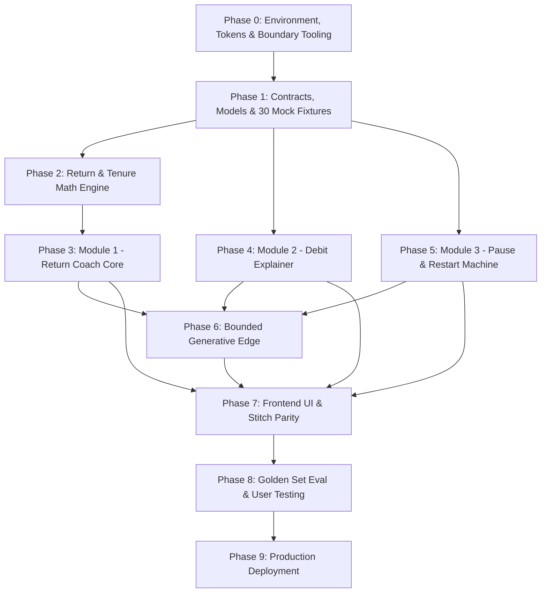

# Implementation Plan: SIP Steady MVP

**Document Version:** 2.0.0 (Updated post Stitch Design & Research Integration)  
**Status:** Approved for Implementation  
**Inputs & Dependencies:**
- [problem-statement.md](../../problem-statement.md)
- [design-system.md](../../design-system.md)
- [architecture.md](architecture.md)
- [edge-case.md](edge-case.md)
- Stitch Design System & Screens (`stitch_indmoney_sip_confidence_experience/`)

---

## 1. Plan Principles & Gating Rules

1. **Strict Phase Gating:** Phases must be executed sequentially. No phase begins until the Definition of Done (DoD) of the previous phase is met and verified with test evidence.
2. **Deterministic Core Before Generative Edge:** All calculations, rules, state machines, templates, citations, and disclaimers must be 100% operational and testable without invoking any LLM API.
3. **Calm-by-Default & Compliance Enforced Early:** Linting for banned advice phrases, pressure language, and unapproved color assignments (e.g. coral on negative returns) is introduced in Phase 0 and enforced continuously.
4. **Data Isolation via Contracts & 30 Personas:** All data flows through the typed `SipDataProvider` interface. The MVP operates on 30 reproducible, PII-free mock personas representing all target archetypes, 7 payment-failure categories, and edge cases.
5. **Exact Integer Arithmetic:** All monetary values are held in integer paise, and NAV/units are held in integers scaled by 10,000, eliminating floating-point math drift.
6. **Derived State Consistency:** SIP status is strictly derived from settled instalments, active pause schedules, and mandate status. Pauses with resume dates $\le 14$ days away evaluate to `RESTART_PENDING`.

---

## 2. Phase Roadmap Overview

| Phase | Phase Name | Primary Deliverable | Key Phase Gate |
| :---: | :--- | :--- | :--- |
| **Phase 0** | **Environment, Design Tokens & Boundary Tooling** | Next.js 16.4.5 + React 19 setup, ESLint 9 flat config, Tailwind design tokens, boundary & banned-phrase linters. | Clean build, boundary lint passing, zero design token violations. |
| **Phase 1** | **Domain Contracts, Data Models & 30 Mock Fixtures** | Zod schemas, integer paise & $10^4$ scaled units, 30 typed persona fixtures, demo time-travel clock. | 100% fixture validation passing; zero floating-point money. |
| **Phase 2** | **Deterministic Return & Tenure Calculation Engine** | Pure TS math engine: XIRR bisection, absolute returns, tenure bands, derived status, confidence scoring. | Math matches reference spreadsheet vectors across all 30 fixtures within 1e-9 tolerance. |
| **Phase 3** | **Module 1: Return Coach (Deterministic Core)** | 3-block narrative templates, AMFI/SEBI source library, placeholder formatter, non-advice refusal interceptor. | Deterministic responses generated; 100% advice refusal on test prompts; zero digits in templates. |
| **Phase 4** | **Module 2: Rules-Based Debit Explainer** | `debit-rules.v1.json` (7 failure categories), reason mapping, active status confirmation, 1-click retry logic. | 100% test coverage on known failure codes; generic fallback for unmapped codes. |
| **Phase 5** | **Module 3: Pause & Restart State Machine** | 3-way comparison matrix (Pause/Reduce/Cancel), lifecycle state machine with 14-day `RESTART_PENDING`, opt-in calm reminders. | State machine transitions verified; zero guilt/urgency language in reminders. |
| **Phase 6** | **Bounded Generative Edge & Compliance Safeguards** | Zero-digit LLM rephraser, placeholder validator, instant fallback to deterministic template. | 100% rejection of model outputs containing digits or banned phrases. |
| **Phase 7** | **Frontend UI & Stitch Parity Implementation** | Next.js App Router views, dark/light themes, signature Navy Hero card, accumulation sparkline, 44px hit targets, Demo Drawer. | WCAG 2.2 AA audit passing; zero coral on negative returns; full keyboard navigation. |
| **Phase 8** | **Comprehensive Quality Gates & Usability Testing** | 40-scenario golden set evaluation, compliance audit, test runs with target segment users. | $\ge 95\%$ rule accuracy, 100% advice refusal, 0 hallucinated figures, 3 user walkthroughs. |
| **Phase 9** | **Production Readiness & Deployment** | Vercel production deployment, health endpoints, audit logging, documentation. | Live demo URL active; health checks green; audit logging verified. |

---

## 3. Detailed Phase Specifications



---

### Phase 0: Environment, Design Tokens & Boundary Tooling

**Objective:** Establish a rock-solid Next.js App Router project with TypeScript strict mode, modernized ESLint 9 flat config, Tailwind CSS design tokens matching Stitch, dark/light theme switching, and automated boundary enforcement.

**Key Tasks:**
1. **Initialize Project:** Next.js `16.4.5` (App Router, Turbopack), React 19, TypeScript 5.6+ (strict mode enabled).
2. **Implement Design Tokens (`design-system.md` & Stitch):**
   - Configure Tailwind with `--ind-canvas`, `--ind-surface-1`, `--ind-surface-2`, `--ind-surface-elevated`, `--ind-border-subtle`.
   - Implement updated text tokens: `--ind-text-muted` (`#5A6A7F` light, `#8896AB` dark; QA-07 contrast fix).
   - Add light-mode text variant tokens (`#0052CC` blue, `#007A5C` emerald, `#C2410C` coral, `#92400E` amber) and dark-mode text variants (`#60A5FA` blue, `#F4806A` coral) to ensure WCAG 2.2 AA contrast.
   - Configure font families (`Inter`, `JetBrains Mono` for tabular numerals).
3. **Theming Architecture:**
   - Dark mode as default (`<html className="dark">`).
   - Pre-paint theme persistence script using `localStorage["ind_theme"]`.
4. **Boundary & Compliance Linters:**
   - **Architecture Boundary Rule:** Prohibit `src/domain/*` from importing any LLM or AI completion library.
   - **Financial Data Rule:** Reject any float usage for currency (enforce integer paise).
   - **Banned-Phrase Linter:** Scan text for urgency, guilt, and advice words (`should buy`, `must sell`, `act now`, `streak broken`).
5. **Testing Harness:** Configure Vitest 5 and Playwright.

**Deliverables:**
- Working Next.js baseline with clean `npm run build`, `npm run lint` (ESLint 9 flat config), and `npm run test`.
- Verified dark/light mode toggle with zero hydration mismatch.

**Phase Gate 0 Checklist:**
- [x] TypeScript strict mode enabled with 0 warnings.
- [x] Banned-phrase linter correctly flags violations.
- [x] Architectural boundary linter prevents illegal domain imports.

---

### Phase 1: Domain Contracts, Data Models & 30 Mock Fixtures

**Objective:** Define strongly typed Zod contracts and 30 realistic, PII-free mock data fixtures representing all research archetypes, 7 payment failure categories, and evaluation test cases.

**Key Tasks:**
1. **Contract Definitions (`src/contracts/`):**
   - Define TypeScript types and Zod schemas for `SipAccount`, `Instalment`, `ValuationSnapshot`, `DebitEvent`, `PauseRecord`, `VerifiedSource`, `Feedback`.
   - Enforce `CurrencyPaise = number` (integer paise) and `ScaledNumber = number` (NAV and units scaled by $10^4$).
2. **Pluggable Data Provider (`src/data/provider.ts`):**
   - Create `SipDataProvider` abstract interface (`getSip`, `getInstalments`, `getValuation`, `getDebitEvents`, `getPauseRecord`).
   - Implement `MockDataProvider` reading from local JSON fixtures.
3. **30 Mock Persona Fixtures (`src/data/mock/fixtures/`):**
   - Core research personas: `early-flat` (primary target), `positive` (calm continuer), `new-month-1` (insufficient tenure fallback), `cashflow-pause` (P02 case), `disconfirming-continuer` (P04 case).
   - 7 Payment failure categories: `debit-upi-limit`, `debit-insufficient-funds`, `debit-bank-down`, `debit-mandate-expired`, `debit-mandate-rejected`, `debit-network-timeout`, `debit-no-reason`.
   - Lifecycle & anomaly fixtures: `pause-scheduled`, `pause-restart-pending`, `cancelled-with-failure`, `debit-recovered`, `xirr-fails`, etc.
   - Each persona declares expected status, return band, and intentional anomalies for validator cross-checking.
4. **Demo Clock (`src/lib/clock.ts`):**
   - Implement a time-travel clock to advance or rewind dates for scenario testing without modifying raw fixture data.

**Phase Gate 1 Checklist:**
- [x] All 30 persona fixtures pass Zod validation.
- [x] Zero floating-point numbers in money and unit attributes.
- [x] No real user PII (no names, real account numbers, or PANs).

---

### Phase 2: Deterministic Return & Calculation Engine

**Objective:** Build a pure TypeScript math and classification engine that calculates absolute returns, tenure, bisection XIRR, derived status, and confidence scores deterministically.

**Key Tasks:**
1. **Paise & Scaled Currency Math (`src/domain/returns/money.ts`):**
   - Integer arithmetic for paise additions, subtractions, and Indian number formatting (`₹1,25,000.00`).
   - Units and NAV arithmetic scaled by $10^4$.
2. **Tenure & Period Calculator (`src/domain/returns/tenure.ts`):**
   - Calculate tenure in completed calendar months from first successful instalment date.
   - Stage mapping: `M1` (<1 mo), `M1_3` (1–3 mo), `M3_6` (3–6 mo), `M6_12` (6–12 mo), `OVER_12` (>12 mo).
3. **Absolute Return & XIRR Solver (`src/domain/returns/xirr.ts`):**
   - Absolute return formula: $A = V - I$, $A\% = (V - I) / I \times 100$.
   - Arbitrary-precision XIRR solver using Decimal.js bracketed bisection + Newton-Raphson.
   - Return `null` safely if $<2$ cash flows or flows do not change sign.
   - Apply short-tenure disclaimer flag when tenure $<12$ months.
4. **Derived Status Engine (`src/data/status.ts`):**
   - Evaluates `ACTIVE`, `ACTIVE_WITH_ALERT`, `PAUSED`, `RESTART_PENDING` (pause resume date $\le 14$ days away), `CANCELLED`.
5. **Situation Band Classifier (`src/domain/returns/classify.ts`):**
   - Evaluates performance into: `FLAT`, `SMALL_NEGATIVE`, `NEGATIVE`, `SMALL_POSITIVE`, `POSITIVE`, or `INSUFFICIENT_DATA` using thresholds in `bands.v1.json`.
6. **Confidence Rating Engine (`src/domain/confidence/`):**
   - Assigns `HIGH`, `MEDIUM`, or `LOW` deterministically based on data completeness and rule matching.

**Phase Gate 2 Checklist:**
- [x] 100% unit test coverage across `src/domain/returns/`.
- [x] XIRR solver matches independent Excel reference vectors within 1e-9 tolerance.
- [x] Single cash flow or invalid dates cleanly return `null` without throwing uncaught exceptions.

---

### Phase 3: Module 1 — Return Coach Core (Deterministic Templates & Citations)

**Objective:** Build the Return Coach domain orchestrator and narrative generator utilizing deterministic templates, AMFI/SEBI citations, and strict non-advice refusal.

**Key Tasks:**
1. **Template & Content Repository (`src/content/templates/`):**
   - Author structured templates for each tenure stage and return situation.
   - Structure every narrative into three required blocks:
     * *Block 1: Your figures*
     * *Block 2: What this means at month N*
     * *Block 3: What it does not mean*
2. **Source & Citation Library (`src/domain/sources/`):**
   - Store verified entries with publisher (AMFI, SEBI), title, publication date, and citation excerpt.
   - Deterministic matching linking relevant citations to the user's specific tenure and asset class.
3. **Placeholder Replacement Engine:**
   - Replace tokens (`{{invested}}`, `{{current_value}}`, `{{abs_return_pct}}`, `{{tenure_months}}`) with formatted values from Phase 2.
4. **Deterministic Intent Guard & Advice Refusal:**
   - Detect advice-seeking keywords (*"should I stop"*, *"which fund is better"*, *"will it recover"*).
   - Return static refusal template with persistent disclaimer: *"Explains your SIP figures. Not investment advice."*
5. **Coach Route Handler:** Implement `POST /api/v1/sips/{id}/coach` returning Zod-validated JSON.

**Phase Gate 3 Checklist:**
- [x] Return Coach generates valid 3-block responses for all 30 mock personas.
- [x] 100% advice-refusal rate on test prompts.
- [x] Zero unformatted or unparsed `{{placeholder}}` tokens in output.

---

### Phase 4: Module 2 — Rules-Based Debit Explainer

**Objective:** Implement the deterministic debit failure triage engine to provide immediate clarity on payment failures across all 7 categories without LLM dependencies.

**Key Tasks:**
1. **Rules Matrix (`src/rules/debit-rules.v1.json`):**
   - Define diagnostic mappings for all 7 failure scenarios: `UPI_DAILY_LIMIT`, `INSUFFICIENT_FUNDS`, `BANK_UNAVAILABLE`, `MANDATE_EXPIRED`, `MANDATE_REJECTED`, `NETWORK_TIMEOUT`, `GENERIC_UNKNOWN`.
2. **Debit Engine Evaluator (`src/domain/debit/`):**
   - Map raw provider failure codes to:
     * **Human Reason:** Plain-language explanation of why the debit did not go through.
     * **SIP Status:** Unambiguous status confirmation (e.g. *Active · 1 failed instalment*).
     * **Next Action:** Single clear button (e.g. *Pay ₹X manually now*, *Re-authorize Autopay*).
3. **Retry & Action Handler:**
   - Logic to determine if immediate manual retry is permitted or if an automated bank retry is scheduled.
4. **API Endpoints:**
   - `GET /api/v1/sips/{id}/debit-events`: Lists past debit events with status chips.
   - `GET /api/v1/debit-events/{id}/explain`: Returns detailed diagnosis.
   - `POST /api/v1/debit-events/{id}/retry`: Mock retry execution endpoint.

**Phase Gate 4 Checklist:**
- [x] Every mapped error code generates the correct human explanation and status chip.
- [x] Unmapped or unknown error codes trigger the safe fallback without failing.
- [x] Confirmation that a failed debit never displays the SIP as cancelled unless the mandate is explicitly revoked.

---

### Phase 5: Module 3 — Pause & Restart State Machine

**Objective:** Implement transparent Pause vs. Reduce vs. Cancel evaluation, the pause lifecycle state machine with 14-day `RESTART_PENDING`, and opt-in calm restart reminders.

**Key Tasks:**
1. **Options Comparison Logic (`src/domain/pause/options.ts`):**
   - Construct side-by-side data comparing **Pause**, **Reduce Amount (Step-down)**, and **Cancel** with explicit consequences for each.
2. **Pause Lifecycle State Machine (`src/domain/pause/machine.ts`):**
   - Transitions: `ACTIVE` $\rightarrow$ `SCHEDULED_PAUSE` $\rightarrow$ `PAUSED` $\rightarrow$ `RESTART_PENDING` $\rightarrow$ `RESUMED` / `CANCELLED`.
   - Date calculator validating pause duration (e.g. 1 to 6 months or until explicit resumption).
3. **Opt-in Non-Urgent Reminder Scheduler:**
   - Preference storage for reminders (`optInReminder: boolean`, `reminderDate: string`).
   - Calm copy generator: Factual status update only, offering equal actions (*Resume*, *Extend*, *Keep Paused*).
   - Zero guilt, zero FOMO, and zero streak warnings.
4. **API Endpoints:**
   - `GET /api/v1/sips/{id}/options`: Returns the 3-option comparison payload.
   - `POST /api/v1/sips/{id}/pause`: Creates a scheduled or immediate pause.
   - `PATCH /api/v1/pauses/{id}/resume`: Resumes an active or scheduled pause.

**Phase Gate 5 Checklist:**
- [x] State machine handles all valid and invalid transitions cleanly.
- [x] Pausing an active SIP properly preserves the mandate status.
- [x] Reminder copy passes the banned-phrase linter with 0 violations.

---

### Phase 6: Bounded Generative Edge & Compliance Safeguards (Optional AI Layer)

**Objective:** Integrate an optional LLM rephrasing service bounded by a strict zero-digit generation policy and automated compliance linters.

**Key Tasks:**
1. **Rephraser Interface & Prompts (`src/domain/explain/rephraser.ts`):**
   - Server-side only completion caller.
   - System prompt strictly mandating: *Preserve all {{placeholder}} tokens verbatim; do not generate any numeric digits; do not provide financial advice.*
2. **Zero-Digit & Placeholder Validator (`src/domain/explain/validator.ts`):**
   - Rejects output if any digit (`0-9`) appears outside allowed template structures.
   - Validates that all placeholders match the input fact object exactly.
3. **Automated Fallback Router:**
   - On LLM timeout, malformed JSON, digit detection, or banned-phrase hit: instantly discard generation and serve the deterministic template from Phase 3.
4. **Audit Logging:** Record template ID, model version, validation status, and latency.

**Phase Gate 6 Checklist:**
- [x] Synthesized test output with injected numbers is rejected 100% of the time.
- [x] Disabling LLM via environment variable (`LLM_ENABLED=false`) results in seamless deterministic operation.

---

### Phase 7: Frontend UI Implementation & Stitch Parity Verification

**Objective:** Build high-polish, accessible Next.js views adhering strictly to the Stitch screen specifications and design system tokens in both dark and light modes.

```
Component Breakdown (Stitch Parity):
├── AppHeader (Sticky, frosted surface, theme toggle, network/battery header)
├── NetWorthHero (Deep navy gradient, tabular numbers, eye privacy mask)
├── AccumulationSparkline (Rupee cost averaging & unit accumulation micro-visualizer)
├── ReturnCoachBanner ("Why is my 5-month SIP in the negative?")
├── StatusChip (Icon + text: Active [emerald], Alert [amber], Paused [blue], Restart Pending [amber/blue], Failed [coral])
├── MetricDisplay (Invested vs Current Value, tabular-nums)
├── CoachCard (3-block explanation, term bottom sheets for XIRR/NAV/Abs Return, source pill)
├── DebitAlertBanner (Failure explanation, 1-tap retry button, pay confirm sheet)
├── OptionsComparisonMatrix (Equal weight cards for Pause / Reduce / Cancel)
├── CalmReminderInboxCard (Factual resume prompt with Resume / Extend / Leave paused)
└── DemoDrawer (Persona switcher for 30 personas, time-travel demo clock, rule inspector)
```

**Key Tasks:**
1. **Core Layout & Navigation:**
   - Implement `AppHeader`, `ThemeToggle`, and responsive viewport shell (mobile-first, 360px to 1280px).
2. **SIP Detail Dashboard (`/sip/[id]`):**
   - `NetWorthHero` with deep navy background, current value, total invested, and tenure badge.
   - `AccumulationSparkline` showing unit accumulation trajectory.
   - Contextual Return Coach entry banner with direct navigation to coach views.
   - Privacy-mask toggle to conceal absolute rupee figures.
   - Status chip displaying active/paused/alert state.
3. **Return Coach Screen (`/sip/[id]/coach` & `/explanation`):**
   - Contextual question picker and 3-tier explanation layout.
   - Interactive term bottom sheets (`XIRR`, `Absolute Return`, `NAV`) with verified definitions.
   - Persistent disclaimer banner and feedback toggles (*"Was this clear?"*, *"Did this feel like advice?"*).
4. **Debit Explainer Screen (`/sip/[id]/debit/[eventId]`):**
   - Failure card with plain-language cause, SIP continuity indicator, and primary retry button.
   - Bottom confirmation sheet (`08-pay-confirm-sheet`) and success screen (`09-pay-success`).
5. **Pause & Restart Screen (`/sip/[id]/pause`):**
   - Comparison grid (*Pause vs Reduce vs Cancel*).
   - Date picker for pause end date and calm reminder toggle.
   - Pause confirmation screen with 60-second undo link.
6. **Demo Drawer:** Hidden toggle to switch among all 30 personas, advance the demo clock, and inspect raw domain calculation payloads.

**Phase Gate 7 Checklist:**
- [x] Zero coral styling on flat or negative returns in both themes.
- [x] WCAG 2.2 AA contrast verified across all text elements in dark and light modes (including `#5A6A7F`/`#8896AB` muted text).
- [x] All touch targets $\ge 44 \times 44$ px.
- [x] All numerical figures render with `tabular-nums`.

---

### Phase 8: Comprehensive Quality Gates, Golden Set Evaluation & Usability Testing

**Objective:** Subject the complete system to rigorous automated quality gates, golden set evaluation, and real-user testing with the target segment.

**Key Tasks:**
1. **Automated Test Suites:**
   - Execute all unit, integration, and Playwright end-to-end journey tests.
2. **40-Scenario Golden Set Evaluation:**
   - 15 Debit failure cases (verify 100% accurate diagnosis and status across all 7 categories).
   - 15 Adversarial advice queries (verify 100% deterministic refusal).
   - 10 Edge cases (missing XIRR, single instalment, leap years).
3. **Accessibility Audit:**
   - Automated axe-core scan; verify full keyboard navigation and screen-reader labels.
4. **User Usability Walkthroughs:**
   - Test prototype with at least 3 users matching the *Uncertain Newcomers* and *Debit Disrupted* profiles.
   - Measure task completion rate and record feedback on return clarity and debit recovery steps.

**Phase Gate 8 Checklist:**
- [x] $\ge 95\%$ accuracy on golden set rules evaluation.
- [x] 100% advice-refusal rate with 0 exceptions.
- [x] 0 hallucinated figures or unverified claims.
- [x] Usability test report documented with actual observed findings.

---

### Phase 9: Production Readiness & Deployment

**Objective:** Deploy the verified prototype to production infrastructure with health monitoring, audit logging, and final documentation.

**Key Tasks:**
1. **Production Build & Environment Config:**
   - Optimize bundle; verify all runtime environment variables with Zod.
2. **Deployment:** Deploy to Vercel or cloud container host.
3. **Observability & Health Checks:**
   - Verify `/api/v1/health` endpoint reporting uptime and configuration status.
   - Enable anonymized audit logging for explanation generations.
4. **Final Documentation:** Update project documentation, README quickstart, and prototype walk-through guide.

**Phase Gate 9 Checklist:**
- [x] Production build deployed and accessible via public HTTPS URL.
- [x] Health check returning HTTP 200 OK.
- [x] All 30 demo personas demonstrable in the live environment.

---

## 4. Summary & Verification

This implementation plan directly delivers on:
* **The Problem Statement:** Eliminates return ambiguity, debit confusion, and cash-flow churn.
* **The Design System & Stitch Screens:** Guarantees dark-first, calm visual hierarchy, AA accessibility, signature Navy hero, sparklines, and zero panic-inducing red numbers for market drops.
* **The Architecture:** Enforces a clean separation between deterministic calculation engines, 30-persona fixtures, integer paise arithmetic, and the bounded zero-digit generative edge.

