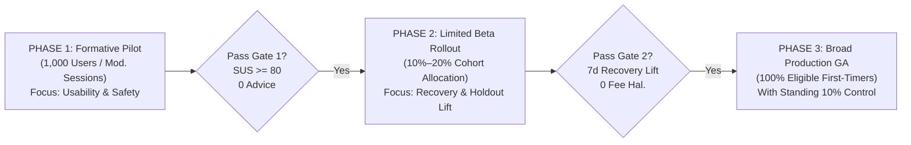

# Go-to-Market (GTM) Strategy & Phased Rollout Plan: SIP Steady

**Document Status:** Proposed Strategic Proposal (Graduation Project Specification)  
**Version:** 1.0.0 (Pre-Approval Rollout Architecture)  
**Target Product:** INDmoney SIP Confidence and Recovery Engine (`SIP Steady`)  
**Product Stage:** Proposed Feature Architecture / Functional Prototype (Not deployed in live production; pending formal INDmoney review)  
**Dependencies:**
- [`docs/metrics-framework.md`](metrics-framework.md)
- [`docs/guardrail-metrics.md`](guardrail-metrics.md)
- [`docs/evaluation-framework.md`](evaluation-framework.md)
- [`docs/usability-testing-plan.md`](usability-testing-plan.md)

---

## 1. Executive Summary & GTM Principles

This document defines the proposed phased release strategy for introducing the **SIP Steady** retention engine into the INDmoney ecosystem. 

```
┌────────────────────────────────────────────────────────────────────────────────────────┐
│                                GTM ETHICS & ROLLOUT RULES                              │
├──────────────────────────────┬──────────────────────────────┬──────────────────────────┤
│ 1. NO PRODUCTION CLAIMS      │ 2. SAFETY GATES BEFORE SCALE │ 3. STANDING HOLDOUT      │
│ • Proposed academic project  │ • Progression is gated by    │ • 10% unexposed holdout  │
│   proposal; not deployed or  │   compliance and safety gates│   maintained continuously│
│   approved by INDmoney yet   │   (zero advice, zero fees)   │   for true causal delta  │
└──────────────────────────────┴──────────────────────────────┴──────────────────────────┘
```

The rollout follows a conservative 3-phase progression designed to validate comprehension, verify deterministic accuracy, and observe real-world behavioral changes before expanding reach:



---

## 2. Phase 1: Small Pilot with First-Time Investors

### 2.1 Strategic Objective
Validate usability comprehension, test cognitive clarity on flat/negative returns, and confirm that the deterministic calculations operate with $100\%$ zero-advice compliance in real-world environments.

### 2.2 Target Users
* **Cohort:** Verified first-time mutual fund investors on INDmoney within their first 1–6 months of SIP tenure ($n \approx 1,000$ enrolled users).
* **Segment Emphasis:** *Uncertain Newcomers* (investors holding a single active monthly equity SIP who have experienced at least one flat, negative, or missed debit event).
* **Exclusions:** Seasoned investors ($> 2$ years tenure), multi-asset HNI clients, and accounts flagged for legal/KYC remediation.

### 2.3 Rollout Scope
* **Channel:** Web and Android (Beta opt-in release / internal staging cohort).
* **Sample Allocation:** Staged invite to 1,000 qualifying users; concurrent execution of 5–8 moderated qualitative think-aloud usability sessions per [`docs/usability-testing-plan.md`](usability-testing-plan.md).

### 2.4 Product Capabilities Active
* **Return Coach (P1 Deterministic Template Mode):** In-situ card on SIP Detail screen; BigInt/Decimal XIRR and $A\%$ calculations; 4 performance band templates; static AMFI/SEBI source library; on-demand Term Sheet (`XIRR`, `Absolute Return`, `NAV`).
* **Debit Explainer (Rules Engine):** Static lookup on 7 failure categories; status chip (`MISSED_CONTINUES`); manual 1-tap retry button.
* **Non-Advice Interceptor:** Deterministic pre-filter blocking all advice, recommendation, and market-timing inquiries.
* **LLM Status:** **Strictly Disabled (`LLM_ENABLED=false`)**; all text rendered from pre-approved, audited templates.

### 2.5 Active Experiments
* **Experiment E0 (Moderated Reading & Usability):** 5–8 moderated sessions testing comprehension of flat/negative returns, term clarity, and the advice-refusal card.
* **Passive Telemetry Calibration:** 30-day silent tracking of unassisted failure views and natural drop-off rates to establish production baseline metrics.

### 2.6 Success Measures
* **System Usability Scale (SUS):** Average $\text{SUS} \ge 80.0 / 100$ across moderated sessions.
* **Task Success Rate:** $\ge 85\%$ unassisted completion on identifying negative return meaning and checking SIP active status.
* **Advice Refusal Compliance:** Exactly $100\%$ refusal on advice-seeking test queries.
* **Technical Error Rate:** $< 0.1\%$ unhandled API exceptions.

### 2.7 Exit Criteria to Phase 2 (Gating Requirements)
1. Complete execution and sign-off of 5–8 moderated user sessions with zero Critical (P0) usability defects.
2. Passing the 40-scenario evaluation harness with $\ge 95\%$ accuracy on rule questions, $100\%$ advice refusal, and $0$ invented fees.
3. Formal Legal & Compliance review confirming that "What this means at this stage" wording does not constitute investment advice under SEBI (Investment Advisers) Regulations.
4. Core banking verification of raw UPI Autopay / e-mandate error codes mapped in `debit-rules.v1.json`.

---

## 3. Phase 2: Limited Rollout with Feedback & Iteration

### 3.1 Strategic Objective
Measure initial behavioral impact, observe leading indicators of drop-off mitigation, test the opt-in restart reminder mechanism, and iterate on copy based on live feedback.

### 3.2 Target Users
* **Cohort:** First-time mutual fund SIP investors registered in the current quarter ($n \approx 10,000 \text{ to } 25,000$ accounts).
* **Segment Breakdown:** Broad newcomer base, capturing natural distributions of regular continuers, debit-disrupted users, and cash-flow pausers.

### 3.3 Rollout Scope
* **Allocation:** **$10\% \text{ to } 20\%$ randomized treatment allocation** of the eligible first-time investor cohort.
* **Control Group:** A clean $10\%$ randomized holdout cohort receiving standard INDmoney UI (no Return Coach card, generic bank failure notice, standard cancellation flow).
* **Platforms:** Full release across Android, iOS, and Responsive Web.

### 3.4 Product Capabilities Active
* **All Phase 1 Features Activated.**
* **Pause and Restart Controls:** 3-way equal comparison matrix (*Pause vs Reduce vs Cancel*); calendar resume date picker; derived status machine (`RESTART_PENDING` activated $\le 14$ days before restart).
* **Opt-In Restart Reminders:** Single, neutral in-app reminder scheduled for opted-in users (strictly unchecked by default).
* **Exit Feedback Collector:** In-line feedback widget on Return Coach (*"Was this clear?"*, *"Did this feel like financial advice?"*).

### 3.5 Active Experiments
* **Experiment E1 (Return Coach Impact):** Randomized trial measuring 30-day pause/cancellation rates following an investor's first encounter with a flat or negative return ($\le 0\%$).
* **Experiment E2 (Debit Explainer Recovery):** A/B test comparing generic failure notice against the structured 3-part explainer modal, measuring 7-day manual retry recovery.
* **Experiment E3 (Pre-Debit Visibility):** Testing voluntary opt-in day-before reminders for users with past balance shortfalls.

### 3.6 Success Measures
* **Explanation View-to-Feedback Ratio:** $\ge 15\%$ user response rate on the clarity feedback card.
* **Clarity Feedback:** $\ge 90\%$ positive responses (*"Was this clear? Yes"*).
* **Failed Debit Recovery (Leading Indicator):** Statistically significant lift ($\ge +5.0\%$ relative improvement) in 7-day payment recovery over holdout.
* **Pause vs Cancel Pivot:** At least $15\%$ of users exhibiting cancellation intent choose "Pause" or "Reduce Amount" instead.
* **Guardrail Metric Compliance:** "Felt like advice" feedback $< 0.5\%$; notification opt-out rate $< 1.0\%$.

### 3.7 Exit Criteria to Phase 3 (Gating Requirements)
1. Minimum 8 weeks of continuous live telemetry with zero P0 safety incidents.
2. Verified statistical non-inferiority in customer support contacts ($\Delta \le 0\%$ support tickets per exposed user).
3. Zero duplicate debit deductions recorded across all manual retry flows.
4. Independent verification that pause reminders trigger exactly once with zero recurring spam.

---

## 4. Phase 3: Broader Rollout & Long-Term Compounding

### 4.1 Strategic Objective
Scale the intervention across the entire first-time investor population, establish long-term compounding habit retention, and confirm causality against the 12-Month Active SIP Rate ($A_{12}$).

### 4.2 Target Users
* **Cohort:** $100\%$ of first-time mutual fund investors on INDmoney entering month 1 through month 12 of their SIP journey.

### 4.3 Rollout Scope
* **General Availability (GA):** Default experience across INDmoney Mobile (Android/iOS) and Web.
* **Standing Control Holdout:** A persistent, randomized **$10\%$ control group** maintained indefinitely to measure true longitudinal incrementality on the North Star Metric.

### 4.4 Product Capabilities Active
* **Full SIP Steady Suite:**
  - Automated Return Coach across all portfolio detail and transaction surfaces.
  - Full-coverage Debit Explainer mapped to all verified NPCI, bank, and aggregator reason codes.
  - Complete Pause, Reduce, and Restart state machine integrated with partner AMC systems.
* **Optional Generative Path (Phase 7 Scope):** If and only if the LLM Rephrase pipeline passes all 14 validator suite checks and human rater benchmarks ($H1 \ge 4.0, H3 = \text{No}$), enable dynamic rephrasing behind strict placeholder validation. If any check fails, system stays on P1 deterministic templates.

### 4.5 Active Experiments
* **Experiment E4 (Pause Reactivation):** Measuring 60-day reactivation rates of paused SIPs with opt-in reminders vs paused SIPs without reminders.
* **Longitudinal NSM Confirmation:** Annual cohort analysis tracking the conditional stage survival probabilities ($s_1, s_2, s_3, s_4$) and lapsed revival rate ($r$).

### 4.6 Success Measures & Target KPIs
* **North Star Metric ($A_{12}$):** Statistically significant lift in 12-month active SIP retention rate against the 10% unexposed holdout cohort.
* **Stage Survival 3–6 Months ($s_3$):** Measurable reduction in month 3–6 drop-offs (the primary problem area identified in research).
* **7-Day Debit Recovery ($P2/DE$):** Sustained recovery rate $\ge 25\%$ across all non-liquidity failed debits.
* **Compliance Floor:** $100\%$ advice refusal rate maintained across all live automated audits.

### 4.7 Ongoing Governance & Maintenance
* **Quarterly Content & Source Audit:** Review all cited AMFI and SEBI URLs to ensure zero broken links and update historical return band distributions against recent market cycles.
* **Monthly Debit Code Refresh:** Re-sync `debit-rules.v1.json` with new bank sub-codes emitted by payment rails.
* **Standing Regulatory Review:** Semi-annual legal inspection of copy against updated SEBI regulatory circulars.

---

## 5. Phase Comparison Matrix

| Attribute | Phase 1: Formative Pilot | Phase 2: Limited Beta Rollout | Phase 3: Broad Production GA |
|:---|:---|:---|:---|
| **Audience Size** | ~1,000 Users + 5–8 Moderated | 10%–20% of Newcomers (~10k–25k) | 100% Eligible Newcomers |
| **Control Group** | None (Pre/Post & Qualitative) | 10% Randomized Holdout | Standing 10% Control Holdout |
| **Focus** | Comprehension & Safety Gates | Leading Lift & Friction Points | 12-Month NSM Incrementality |
| **Core Modules** | Return Coach + Debit Rules | Coach + Debit + Pause/Restart | Full Suite + Optional Rephrase |
| **LLM Status** | Strictly Disabled (P1 Only) | Strictly Disabled (P1 Only) | Optional (Gated by Validator) |
| **Key Gate** | Gate `G-RULE`, `G-ADVICE`, `G-FEES` | Stat. Sig. Recovery Lift ($\ge +5\%$) | NSM Lift & Zero Regulatory Risk |
| **Duration** | 4 Weeks | 8–12 Weeks | Ongoing (Annualized Cohorts) |

