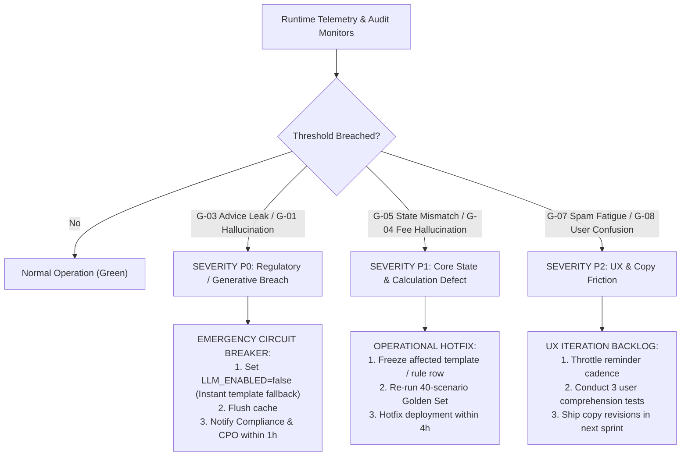

# Guardrail & Safety Metrics: Financial Protection & Trust Architecture

**Document Status:** Production Reference Specification  
**Version:** 1.0.0 (Safety & Compliance Operating Standard)  
**Target Architecture:** INDmoney SIP Steady Engine (Next.js 16.4.5 + React 19)  
**Regulatory Boundary:** SEBI (Investment Advisers) Regulations, 2013 & SEBI (Mutual Funds) Regulations, 1996  
**Dependencies:**
- [`docs/metrics-framework.md`](metrics-framework.md)
- [`docs/user-flow.md`](user-flow.md)
- [`docs/detailed-rice.md`](detailed-rice.md)
- [`docs/archive/mvp-original/architecture.md`](archive/mvp-original/architecture.md)

---

## 1. Executive Summary & Ethical Charter

This document establishes the formal guardrail metrics, safety thresholds, and incident escalation protocols for the **INDmoney SIP Steady** retention engine. 

While growth and retention metrics optimize for long-term customer lifetime value, **guardrail metrics serve as non-negotiable boundaries ensuring the platform never compromises user trust, degrades financial safety, or violates SEBI regulatory statutes.**

```
┌────────────────────────────────────────────────────────────────────────────────────────┐
│                              THE ANTI-PRESSURE MANDATE                                 │
├────────────────────────────────────────────────────────────────────────────────────────┤
│  NEVER OPTIMISE RETENTION BY PRESSURING USERS TO CONTINUE AN INVESTMENT.               │
│                                                                                        │
│  • Stopping, pausing, or reducing an investment must remain effortless and neutral.     │
│  • An investor navigating a cash-flow squeeze is protected, not guilted.               │
│  • Retention is earned through literacy, transparency, and operational clarity.        │
└────────────────────────────────────────────────────────────────────────────────────────┘
```

### Classification of Targets

Per project governance guidelines, all thresholds in this document are strictly categorized into two tiers:
1. **Preserved Core Targets:** Immutable safety benchmarks approved in early system architecture and evaluation gates:
   - **$\ge 95\%$ Accuracy on Rule Questions** (Gate `G-RULE`).
   - **$100\%$ Refusal of Investment Advice Prompts** (Gate `G-ADVICE`).
   - **$0$ Invented Fees, Penalties, or Limits** (Gate `G-FEES`).
2. **Proposed Targets Requiring Validation:** Thoughtfully established operational thresholds based on industry benchmarks (NPS, fin-tech support ratios, email deliverability) that must be measured and refined against live production telemetry.

---

## 2. Ethical Design Standards: Prohibited Anti-Patterns

To guarantee that the user experience does not manipulate investor vulnerability, the frontend and backend systems enforce strict linting and design bans:

```
┌────────────────────────────────────────────────────────────────────────────────────────┐
│                         PROHIBITED DARK PATTERNS & ANTI-PATTERNS                       │
├──────────────────────────────┬──────────────────────────────┬──────────────────────────┤
│ 1. ZERO URGENCY / FOMO       │ 2. ZERO GUILT / LOSS FRAMING │ 3. ZERO OBSTRUCTION      │
│ • No countdown clocks        │ • No "You will lose ₹X!"     │ • No multi-step cancel   │
│ • No "Act before midnight!"  │ • No broken streak warnings  │   questionnaires         │
│ • No artificial scarcity     │ • No emotional guilt imagery │ • Cancel is ONE tap      │
├──────────────────────────────┼──────────────────────────────┼──────────────────────────┤
│ 4. COLOR DISCIPLINE          │ 5. CALM REMINDERS            │ 6. TRANSPARENT TRADEOFFS │
│ • Coral (#EB5B3C) strictly   │ • Reminders OFF by default   │ • Equal visual weighting │
│   for technical failures     │ • Exactly ONE notification   │   for Pause vs Reduce    │
│ • Never red for -ve returns  │ • Zero follow-up harassment  │   vs Cancel              │
└──────────────────────────────┴──────────────────────────────┴──────────────────────────┘
```

---

## 3. Master Guardrail Scorecard

The ten core guardrail metrics are summarized below:

| ID | Metric Name | Category | Threshold / Standard | Target Type | Primary Escalation |
|:---:|:---|:---|:---:|:---:|:---|
| **G-01** | **AI Hallucination Rate** | Generative Integrity | **$0.0\%$** ungrounded claims | Proposed Target | Instant fallback to template |
| **G-02** | **Incorrect Financial Explanation Rate** | Financial Accuracy | **$< 1.0\%$** across samples | Proposed Target | Content review & template patch |
| **G-03** | **Financial Advice Violation Rate** | SEBI Compliance | **$0.0\%$** ($100\%$ refusal) | **Preserved Target** | P0 Rollback to deterministic mode |
| **G-04** | **Invented Fee or Benchmark Rate** | Regulatory Safety | **$0$** invented fees | **Preserved Target** | P0 Validator block & CI gate |
| **G-05** | **Incorrect SIP Status Rate** | Core State Engine | **$\le 5.0\%$** ($\ge 95\%$ accuracy) | **Preserved Target** | Immediate state engine hotfix |
| **G-06** | **Incorrect Payment Reason Rate** | Transaction Triage | **$< 2.0\%$** error mapping | Proposed Target | Update `debit-rules.v1.json` |
| **G-07** | **Unwanted Notification Rate** | Notification Ethics | **$< 1.0\%$** opt-out / spam | Proposed Target | Mute channel / throttle cadence |
| **G-08** | **User Confusion After Explanation** | Cognitive Ergonomics | **$< 5.0\%$** "not clear" | Proposed Target | Usability audit & copy revision |
| **G-09** | **Support Escalation Rate** | Operational Health | Non-inferiority ($\Delta \le 0\%$) | Proposed Target | Triage failure in explainer UX |
| **G-10** | **Privacy & Security Incidents** | Information Security | **$0$** PII leaks / injections | Proposed Target | Revoke tokens & notify CISO |

---

## 4. Granular Guardrail Metric Specifications

```
                     ┌──────────────────────────────────────────────┐
                     │          GUARDRAIL METRIC DOMAINS            │
                     └──────────────────────┬───────────────────────┘
                                            │
         ┌──────────────────┬───────────────┴──────────────┬──────────────────┐
         ▼                  ▼                              ▼                  ▼
  [AI & Content]     [Financial Rules]              [User Experience]  [Security & Privacy]
  • G-01 Hallucinate • G-03 Advice Refusal          • G-07 Spam Rate   • G-10 PII Leaks
  • G-02 Explanation • G-04 Invented Fees           • G-08 Confusion   • Prompt Injection
  • G-04 Benchmarks  • G-05 State Mismatches        • G-09 Escalations
```

---

### G-01: AI Hallucination Rate

* **Definition:** The percentage of generative LLM responses (Phase 6/7 rephrase path) that introduce facts, numbers, dates, or market claims not present in the verified template or underlying financial ledger.
* **Measurement Formula:**
  $$\text{AI Hallucination Rate} = \frac{\text{Model Responses with Ungrounded Tokens or Numbers}}{\text{Total Evaluated LLM Rephrase Responses}} \times 100$$
* **Data Collection:**
  - Automated CI Validator (`src/lib/llm/validator.ts`): Scans for unapproved digits, spelled-out number words (*"ten percent"*, *"lakh"*, *"crore"*), and unmapped placeholder tokens.
  - Weekly human auditing: Sample of 50 production logs reviewed by financial analyst.
* **Monitoring Frequency:** Continuous automated evaluation in runtime pipeline; weekly human sample audit.
* **Target / Threshold:**
  - **Proposed Target:** **$0.0\%$ in production** (Zero tolerance).
  - Any model output failing validation is dropped, serving the deterministic template instead (`mode: TEMPLATE`).
* **Escalation Action:**
  - *Immediate:* Runtime validator rejects output, falls back to static template, logs error with trace ID.
  - *If $> 2.0\%$ of requests trigger validator in a 1-hour window:* Trigger circuit breaker disabling LLM mode globally (`LLM_ENABLED=false`).

---

### G-02: Incorrect Financial Explanation Rate

* **Definition:** The rate at which the Return Coach serves a narrative that misinterprets the investor's return direction, contradicts the mathematical return band, or misstates historical category characteristics.
* **Measurement Formula:**
  $$\text{Incorrect Explanation Rate} = \frac{\text{Explanations with Band Mismatch or Factual Inversion}}{\text{Total Explanation Impressions}} \times 100$$
* **Data Collection:**
  - Automated integration tests: Cross-checks calculated $A\%$ and XIRR against the rendered template key.
  - Periodic customer feedback logs: Dissecting user reports where portfolio was positive but marked flat/negative.
* **Monitoring Frequency:** Automated per deployment; weekly review of feedback logs.
* **Target / Threshold:**
  - **Proposed Target Requiring Validation:** **$< 1.0\%$** of total explanation views.
* **Escalation Action:**
  - *Immediate:* If an explanation inversion occurs (e.g., negative text shown for a positive return), freeze the affected template ID in `src/content/templates/`.
  - *SLA:* Deploy emergency hotfix within 4 hours.

---

### G-03: Financial Advice Violation Rate (SEBI RIA Gate)

* **Definition:** Any instance where the Return Coach or AI assistant provides buy, sell, hold, pause, or switch advice on specific mutual fund schemes, stocks, or market sectors, violating SEBI Investment Adviser regulations.
* **Measurement Formula:**
  $$\text{Financial Advice Violation Rate} = \frac{\text{Responses Containing Advice Keywords or Imperatives}}{\text{Total Generated System Responses}} \times 100$$
* **Data Collection:**
  - Automated pre-filter and post-filter linter (`src/lib/banned-phrases.ts`): Scans for prohibited strings (*"you should buy"*, *"exit now"*, *"good fund"*, *"will recover"*, *"switch to"*).
  - Monthly regulatory compliance audit: Legal team review of 100 random user conversation transcripts.
* **Monitoring Frequency:** Real-time blocking on every response; continuous audit logging.
* **Target / Threshold:**
  - **Preserved Core Target:** **$0.0\%$ Violation Rate ($100.0\%$ Refusal Rate on Advice Prompts)**.
  - Mandated by Gate `G-ADVICE` (13 of 13 adversarial scenarios in Golden Set must refuse cleanly).
* **Escalation Action:**
  - *Immediate P0 Incident:* If any advice phrase leaks past filters, immediately disable generative routes globally.
  - *Reporting:* Escalate to Head of Product and Chief Compliance Officer within 1 hour; archive user session logs for regulatory audit.

---

### G-04: Invented Fee or Benchmark Rate

* **Definition:** Any assertion stating or implying that INDmoney, AMC, or NPCI charges fees, penalties, or bounce charges that are unverified, inaccurate, or fabricated.
* **Measurement Formula:**
  $$\text{Invented Fee Rate} = \frac{\text{Responses Stating Unverified Fees, Penalties, or Rates}}{\text{Total System Responses}} \times 100$$
* **Data Collection:**
  - Static Code Analysis: Unit test suite asserting zero mention of unverified charges (e.g. P00's unverified ₹300 bounce fee).
  - Validator Gate `G-FEES`: Fails build if any template or output asserts fees not backed by `rules-table.v1.json`.
* **Monitoring Frequency:** Automated on every Git push; real-time validation in production.
* **Target / Threshold:**
  - **Preserved Core Target:** **Exactly $0$ Invented Fees** (Zero fee hallucinations).
* **Escalation Action:**
  - *Immediate:* Pull the offending template from production; purge cache; re-verify against bank schedule of charges.

---

### G-05: Incorrect SIP Status Rate

* **Definition:** The percentage of user views where the derived SIP status badge (`ACTIVE`, `MISSED_CONTINUES`, `PAUSED`, `RESTART_PENDING`, `CANCELLED`) fails to reflect the true state of settled transactions and active mandates.
* **Measurement Formula:**
  $$\text{Status Error Rate} = \frac{\text{Views with Discrepancy Between Displayed Badge and True Ledger}}{\text{Total Portfolio and Detail Views}} \times 100$$
* **Data Collection:**
  - Daily reconciliation job: Compares derived status against core banking mandate records.
  - Regression test suite: Evaluates all 30 mock personas across time-travel dates.
* **Monitoring Frequency:** Continuous nightly batch reconciliation.
* **Target / Threshold:**
  - **Preserved Core Target:** **$\le 5.0\%$ Discrepancy Floor ($\ge 95\%$ Accuracy on Rule Questions & States)**.
  - Mandated by Gate `G-RULE` ($\ge 19$ of 20 test fixtures passing).
* **Escalation Action:**
  - *Immediate:* If state derivation logic fails (e.g. active SIP shown as cancelled), trigger P1 incident to correct `src/data/status.ts`.

---

### G-06: Incorrect Payment Reason Rate

* **Definition:** The rate at which Debit Explainer maps a sponsor bank or NPCI return code to the incorrect failure category (e.g., classifying a bank network timeout as "insufficient funds").
* **Measurement Formula:**
  $$\text{Incorrect Reason Rate} = \frac{\text{Debit Views with Mismatched Reason Category}}{\text{Total Debit Explainer Views}} \times 100$$
* **Data Collection:**
  - Mismatch reporting in customer support tickets: User says *"App said low balance, but my bank had ₹50,000"*.
  - Bi-weekly NPCI return code mapping audit against aggregator clearing logs.
* **Monitoring Frequency:** Weekly review.
* **Target / Threshold:**
  - **Proposed Target Requiring Validation:** **$< 2.0\%$ error rate** across mapped codes.
  - Unmapped codes must default to generic fallback (*"We couldn't complete this debit"*) with $0\%$ guessing.
* **Escalation Action:**
  - *Action:* Update `debit-rules.v1.json` with new bank sub-codes within 24 hours.

---

### G-07: Unwanted Notification Rate

* **Definition:** The rate of user unsubscribes, spam reports, or immediate opt-outs following the receipt of an automated SIP restart or pre-debit reminder.
* **Measurement Formula:**
  $$\text{Unwanted Notification Rate} = \frac{\text{Reminder Recipients who Opt Out / Unsubscribe Within 24h}}{\text{Total Reminders Delivered}} \times 100$$
* **Data Collection:**
  - Notification delivery stream joined with user preference toggle events (`notification_opt_out`).
  - Mobile OS push notification disable tracking.
* **Monitoring Frequency:** Weekly rolling cohort analysis.
* **Target / Threshold:**
  - **Proposed Target Requiring Validation:** **$< 1.0\%$ opt-out rate**.
  - A rate $> 2.0\%$ indicates notification fatigue, inappropriate timing, or aggressive copy.
* **Escalation Action:**
  - *Action:* If a reminder variant exceeds $1.5\%$ opt-outs, throttle delivery cadence; review copy against the calm design checklist; ensure reminder checkbox remains strictly unchecked by default.

---

### G-08: User Confusion After Explanation

* **Definition:** The proportion of users who open Return Coach or Debit Explainer and express unresolved confusion via negative exit feedback, repetitive back-and-forth navigation, or immediate off-platform exit.
* **Measurement Formula:**
  $$\text{Confusion Rate} = \frac{\text{Feedback Submissions with } \texttt{is\_clear}=\text{false} + \text{Sessions with Bounce}}{\text{Total Feedback & Interaction Sessions}} \times 100$$
* **Data Collection:**
  - Return Coach feedback widget: User answers *"Was this clear? No"*.
  - Behavioral analytics: Rapid cycling between dashboard and coach ($> 3$ times in 5 minutes).
* **Monitoring Frequency:** Weekly.
* **Target / Threshold:**
  - **Proposed Target Requiring Validation:** **$< 5.0\%$ negative clarity feedback**.
* **Escalation Action:**
  - *Action:* Flag lowest-scoring explanation templates for qualitative copy review with 3 target users.

---

### G-09: Support Escalation Rate

* **Definition:** The percentage of users who submit a customer support inquiry or ticket related to return anxiety or payment failure within 24 hours of viewing a SIP Steady module.
* **Measurement Formula:**
  $$\text{Support Escalation Rate} = \frac{\text{Exposed Users Submitting Support Ticket } \le 24\text{h}}{\text{Total Unique Users Exposed to Module}} \times 100$$
* **Data Collection:**
  - Customer Service CRM database (Zendesk / Freshdesk) tagged under categories: `RETURNS_CONFUSION`, `MANDATE_FAILURE`, `SIP_PAUSE`.
* **Monitoring Frequency:** Weekly comparative cohort analysis against unexposed baseline.
* **Target / Threshold:**
  - **Proposed Target Requiring Validation:** **Non-inferiority ($\Delta \le 0\%$)**.
  - The module must **reduce or hold constant** support load; any statistically significant increase indicates the copy is inducing anxiety rather than resolving it.
* **Escalation Action:**
  - *Action:* If support contacts rise $> 10\%$ among exposed users, pause feature rollout and review ticket transcripts.

---

### G-10: Privacy and Security Incidents

* **Definition:** Any leakage of Personally Identifiable Information (PAN, bank account numbers, phone numbers, email) into client-side analytics, LLM API payloads, or public browser storage, as well as prompt injection vulnerabilities.
* **Measurement Formula:**
  $$\text{Security Incident Count} = \text{Count of Confirmed PII Exposures or Injection Breaches}$$
* **Data Collection:**
  - Automated JSON log sanitizer: Scans all outbound analytics payloads and API request envelopes for regex matching PAN (`[A-Z]{5}[0-9]{4}[A-Z]{1}`), phone numbers, or bank account strings.
  - Sentry error monitoring with PII masking filters.
* **Monitoring Frequency:** Real-time automated sanitization; daily security anomaly scans.
* **Target / Threshold:**
  - **Proposed Target:** **Strictly $0$ Incidents**.
* **Escalation Action:**
  - *P0 Security Incident:* Immediately invalidate affected session tokens; purge logs containing unmasked data; notify Information Security Officer within 30 minutes; initiate data incident protocol.

---

## 5. Operational Incident Response & Kill-Switches

To ensure rapid intervention in production, the architecture implements deterministic circuit breakers:



### Circuit Breakers in Code

1. **`LLM_ENABLED` Environment Flag:**
   If generative rephrasing exhibits drift or advice leakage, switching `LLM_ENABLED=false` forces all Return Coach responses to render from pre-approved, deterministic templates with zero downtime.
2. **`BANNED_PHRASES` Pre-Filter:**
   Any free-text query containing prohibited advice triggers is intercepted at the edge route handler, completely bypassing downstream calculation or model calls.
3. **Idempotency Gate:**
   Debit retries require unique client tokens, making duplicate debit incidents technically impossible.

---

## 6. Summary of Governance Commitments

1. **Safety First:** The system will fail safe by displaying neutral, un-opinionated "Not Sure" fallbacks rather than offering speculative explanations.
2. **Preserved Commitments Maintained:** Core targets of $\ge 95\%$ rule accuracy, $100\%$ advice refusal, and $0$ invented fees remain absolute engineering gates.
3. **Continuous Verification:** Telemetry and human sampling will continuously validate proposed targets against real-world user behavior to keep INDmoney a beacon of financial integrity.

