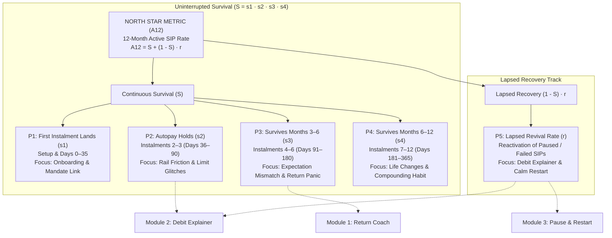

# Metrics Framework: SIP Steady Retention Engine

**Document Status:** Production Reference Specification  
**Version:** 1.0.0 (Baseline Instrumentation Architecture)  
**Research Cut-off:** November 2026  
**Target Platform:** INDmoney Investment Platform (Web & Mobile Apps)  
**Dependencies:**
- [`docs/detailed-rice.md`](detailed-rice.md)
- [`docs/user-flow.md`](user-flow.md)
- [`docs/usability-testing-plan.md`](usability-testing-plan.md)
- [`docs/archive/mvp-original/architecture.md`](archive/mvp-original/architecture.md)

---

## 1. Executive Summary & Strategic Objective

The overarching strategic objective established in the project charter is:

> **Strategic Goal:**  
> **Increase the percentage of first-time mutual fund investors who still have an active SIP 12 months after starting their first.**

To systematically track, diagnose, and drive progress toward this objective, this framework establishes:
1. The formal mathematical definition and cohort boundary rules for the **North Star Metric (NSM)**.
2. A rigorous, mathematically sound **KPI Tree** decomposing the 12-month lifecycle into five distinct survival and revival stages ($P1 \text{ to } P5$).
3. Ten granular **supporting product metrics** spanning the three functional intervention modules: **Return Coach**, **Debit Explainer**, and **Pause and Restart**.
4. A set of non-negotiable **guardrail and compliance metrics** protecting INDmoney against SEBI regulatory advice drift, user spam, and inadvertent churn acceleration.

```
┌────────────────────────────────────────────────────────────────────────────────────────┐
│                               DATA INTEGRITY PRINCIPLES                                │
├──────────────────────────────┬──────────────────────────────┬──────────────────────────┤
│ 1. ZERO INVENTED BASELINES   │ 2. COHORT-STRICT DENOMINATORS│ 3. RIGOROUS DECOMPOSITION│
│ • No synthetic retention     │ • True first-time investors  │ • Cumulative survival    │
│   lifts or historical baselines│   (excluding prior CAS/MF)   │   cannot be summed with  │
│ • Real figures established   │ • Cycle-adjusted activity    │   recovery; must follow  │
│   via live telemetry only    │   for weekly/quarterly SIPs  │   A₁₂ = S + (1 - S) · r  │
└──────────────────────────────┴──────────────────────────────┴──────────────────────────┘
```

---

## 2. North Star Metric (NSM): 12-Month Active SIP Rate ($A_{12}$)

### 2.1 Formal Semantic Definition
The **12-Month Active SIP Rate** measures the percentage of verified first-time mutual fund investors who registered their first SIP in cohort month $M$ and maintain an **active** investment schedule in month $M+12$.

### 2.2 Operational Definition of "Active"
An investor's SIP is classified as **Active** at month 12 if and only if:
$$\text{Status} = \mathbf{Active} \iff \text{The SIP has recorded } \ge 1 \text{ successful settled instalment within its scheduled cycle } + 30 \text{ calendar days.}$$

#### Granular Cohort Denominator Rules
To avoid metric pollution, the cohort denominator $N_{\text{cohort}}$ is strictly governed by the following criteria:
1. **First-Time Mutual Fund Investor Rule:** The user registered their first-ever mutual fund SIP on INDmoney in month $M$, **and** INDmoney's Central Depository Services / Computer Age Management Services (CAS/CAMS) tracker import detects **zero prior mutual fund holdings** from outside platforms. Users with existing external MF portfolios are classified as "Experienced Migrators" and excluded from this cohort.
2. **Exclusion of Lump-Sum-Only Users:** Users who made one-time purchases without an active e-mandate are excluded.
3. **Handling of Non-Monthly SIP Frequencies:** INDmoney supports daily, weekly, monthly, and quarterly SIPs. For quarterly SIPs, the 30-day rule would classify a healthy SIP as "inactive" in 2 out of 3 months. Therefore, "Active" is operationalized as:
   $$\text{Instalment Settled Within } (\text{Schedule Cycle Period} + 30 \text{ Days})$$
4. **Exclusion of Natural Tenure Completions:** Fixed-tenure SIPs that completed their contracted duration (e.g. a 6-month target SIP) before month 12 count as **Completed Tenures**, not lapses. They are reported separately and removed from the active retention denominator.
5. **Anti-Gaming Continuity Guardrail:** An investor cannot be marked active simply by registering an unbacked ₹100 token SIP in month 11. The active SIP must either be the original SIP or a direct, continuous replacement in the same asset category.

### 2.3 Mathematical Formula
$$A_{12} = \frac{\sum_{i=1}^{N_{\text{cohort}}} \mathbb{I}\left(\text{Successful Instalment in } [D_{\text{start}} + 335\text{d}, D_{\text{start}} + 395\text{d}]\right)}{N_{\text{cohort}} - N_{\text{completed\_tenure}}} \times 100$$

Where:
* $N_{\text{cohort}}$ is the total number of qualified first-time SIP investors registered in month $M$.
* $N_{\text{completed\_tenure}}$ is the count of SIPs with predetermined contract lengths $< 12$ months that reached natural completion.
* $\mathbb{I}(\cdot)$ is the indicator function evaluating to $1$ if the condition is met, and $0$ otherwise.

### 2.4 Metadata & Instrumentation
* **Data Sources:** Production Core Banking / SIP Transaction Ledger (`sip_orders`, `mandates`, `bank_debit_logs`).
* **Measurement Frequency:** Evaluated monthly per cohort; monitored continuously via a 90-day leading indicator proxy.
* **Limitations:** The primary drawback of $A_{12}$ is that it is a **lagging metric** requiring a 365-day gestation period. Product releases cannot wait 12 months for a feedback loop; hence, the KPI tree and leading indicator proxies are required.

---

## 3. KPI Tree & Lifecycle Decomposition ($P1 \text{ to } P5$)

### 3.1 Critique of Additive Formulation
Earlier presentation drafts proposed the formula:
$$\text{Flawed Formula: } A_{12} = P_1 \times P_2 \times P_3 \times P_4 + P_5 \quad \text{\textbf{[MATHEMATICALLY INVALID]}}$$

This formulation is mathematically invalid for three fundamental reasons:
1. **Probability Violation:** If $P_1 \dots P_4$ represent survival probabilities, their product $\prod P_i$ represents the probability that a user *never lapses*. Adding an unweighted $P_5$ double-counts users and can result in retention rates exceeding $100\%$.
2. **Incorrect Population Sizing:** Recovery ($P_5$) can *only* operate on the population of users who **did** lapse during the journey.
3. **Corpus Confusion:** Historical percentages cited in early discovery decks ($18.4\%, 6.3\%, 54.2\%, 21.6\%$) represented relative shares of public review complaint clusters, not stage-specific survival rates.

### 3.2 Corrected Cumulative Conditional Survival Model
The mathematically sound decomposition models retention as the sum of **uninterrupted continuous survival ($S$)** plus **the successful reactivation of lapsed investors ($R$)**:

$$A_{12} = S + (1 - S) \cdot r$$

Where:
* $S = s_1 \cdot s_2 \cdot s_3 \cdot s_4$ represents the probability of uninterrupted survival across four sequential stages.
* $s_k = P(\text{Active at end of stage } k \mid \text{Active at start of stage } k)$ is the conditional stage survival probability.
* $r$ is the **Lapsed Revival Rate**—the proportion of investors who experienced an auto-debit failure, pause, or cancellation in stages 2, 3, or 4 but were recovered and active in month 12.



---

### 3.3 The Five KPI Tree Branches ($P1 \text{ to } P5$)

#### P1: First Instalment Success ($s_1$)
* **Stage Focus:** Days 0–35 (Setup, mandate authorization, and first debit execution).
* **Definition:** Percentage of users who register a SIP and successfully settle instalment #1.
* **Formula:**
  $$s_1 = \frac{\text{Cohort Users with Settled Instalment \#1}}{\text{Total First-Time SIP Registrations in Cohort}} \times 100$$
* **Primary Risk:** Drop-off during bank UPI Autopay redirection, OTP failures, or initial mandate rejection.

#### P2: Autopay Holds in Months 2–3 ($s_2$)
* **Stage Focus:** Months 2–3 (Instalments 2 and 3).
* **Definition:** Conditional probability that an investor whose first instalment landed successfully experiences uninterrupted debits on instalments 2 and 3.
* **Formula:**
  $$s_2 = \frac{\text{Investors with Settled Instalments \#1, \#2, and \#3}}{\text{Investors with Settled Instalment \#1}} \times 100$$
* **Primary Risk:** Opaque bank error codes, bank server maintenance on debit dates, and daily UPI limit collisions ($P03$).
* **Primary Intervention:** **Module 2 (Debit Explainer)**.

#### P3: SIP Survives Months 3–6 ($s_3$)
* **Stage Focus:** Months 3–6 (The "Expectation vs Reality / Information Desert" cliff).
* **Definition:** Conditional probability that an investor active at month 3 remains active through month 6 without pausing, cancelling, or abandoning.
* **Formula:**
  $$s_3 = \frac{\text{Investors Active at Month 6}}{\text{Investors Active at Month 3}} \times 100$$
* **Primary Risk:** Panic over early sideways or negative returns ($-2\%$ at Month 5), metric confusion (`XIRR`), and unrealistic expectations of immediate compounding ($P01, P05$).
* **Primary Intervention:** **Module 1 (Return Coach)**.

#### P4: SIP Survives Months 6–12 ($s_4$)
* **Stage Focus:** Months 6–12 (Maturing First-Year Habit).
* **Definition:** Conditional probability that an investor active at month 6 remains active through month 12.
* **Formula:**
  $$s_4 = \frac{\text{Investors Active at Month 12 (Continuous)}}{\text{Investors Active at Month 6}} \times 100$$
* **Primary Risk:** Macroeconomic shifts, income changes, unexpected festival expenses, and competing broker cross-sell offers.
* **Primary Intervention:** **Module 3 (Pause and Restart)**.

#### P5: Lapsed SIP Revival Rate ($r$)
* **Stage Focus:** Reactivation within 60 days of any pause, consecutive failure, or lapse.
* **Definition:** The proportion of investors whose SIP lapsed in stages 2, 3, or 4 who successfully resume active investing before month 12.
* **Formula:**
  $$r = \frac{\text{Lapsed Investors in Stages 2–4 who Settle a Debit in Month 12}}{\text{Total Investors who Lapsed in Stages 2–4}} \times 100$$
* **Primary Risk:** Permanent abandonment following a temporary pause due to lack of restart prompts ($P02$).
* **Primary Intervention:** **Module 2 (1-Tap Retry) & Module 3 (Opt-in Restart Reminder)**.

---

## 4. Supporting Product Metrics: Module-by-Module Specifications

```
┌────────────────────────────────────────────────────────────────────────────────────────────────────────┐
│                                    SUPPORTING PRODUCT METRICS MATRIX                                   │
├─────────────────────────┬───────────────────────────────┬──────────────────────────────────────────────┤
│ MODULE 1: RETURN COACH  │ MODULE 2: DEBIT EXPLAINER     │ MODULE 3: PAUSE AND RESTART                  │
├─────────────────────────┼───────────────────────────────┼──────────────────────────────────────────────┤
│ 1. Explanation          │ 5. Failure Explanation        │ 8. Pause Completion Rate                     │
│    Engagement Rate      │    View Rate                  │                                              │
│ 2. Explanation          │ 6. Next-Step Completion Rate  │ 9. Reminder Opt-In Rate                      │
│    Completion Rate      │                               │                                              │
│ 3. Understanding        │ 7. Successful Recovery Rate   │ 10. Restart Completion Rate                  │
│    Improvement Rate     │                               │                                              │
│ 4. Follow-Up Resolution │                               │                                              │
│    Rate                 │                               │                                              │
└─────────────────────────┴───────────────────────────────┴──────────────────────────────────────────────┘
```

---

### Module 1: Return Coach Metrics

#### Metric 1: Explanation Engagement Rate
* **Definition:** The proportion of investor sessions displaying a flat, negative, or low-return portfolio ($\le 0\%$ or flat band) where the user consciously opens the Return Coach.
* **Formula:**
  $$\text{Engagement Rate} = \frac{\text{Unique Sessions with } \texttt{sip\_coach\_opened}}{\text{Unique Sessions Viewing Portfolio with } \text{Return} \le 0\%} \times 100$$
* **Event Instrumentation:**
  - Impression: `sip_portfolio_viewed` with properties `{ sip_id, return_pct, return_band: "NEGATIVE"|"FLAT" }`.
  - Action: `sip_coach_opened` with properties `{ sip_id, entry_trigger: "WHAT_DOES_THIS_MEAN"|"HERO_BUTTON"|"TERM_CHIP", tenure_months }`.
* **Data Source:** Frontend Analytics Clickstream (`client_event_stream`).
* **Measurement Frequency:** Daily / Weekly.
* **Limitations:** Does not reflect whether the user found the trigger easily or tapped it accidentally. Excludes users with positive returns who were not shown the proactive trigger.

#### Metric 2: Explanation Completion Rate
* **Definition:** The percentage of users who open the Return Coach and scroll through/read all three core narrative blocks (*Your Figures*, *What this means*, *What it does NOT mean*) and view the sources section.
* **Formula:**
  $$\text{Completion Rate} = \frac{\text{Sessions with } \texttt{sip\_coach\_block\_viewed}(\text{block\_id}=\text{"BLOCK\_3"})}{\text{Sessions with } \texttt{sip\_coach\_opened}} \times 100$$
* **Event Instrumentation:**
  - View Tracker: `sip_coach_block_viewed` with properties `{ block_id: "BLOCK_1"|"BLOCK_2"|"BLOCK_3"|"SOURCES", dwell_time_ms }`.
  - Complete: `sip_coach_completed` triggered when Block 3 dwell time $\ge 3$ seconds.
* **Data Source:** Frontend Viewport Intersection Observer logs.
* **Measurement Frequency:** Weekly.
* **Limitations:** Dwell time is a proxy for reading comprehension; a user may keep the modal open without actively reading the prose.

#### Metric 3: Understanding Improvement
* **Definition:** The proportion of Return Coach sessions where the user provides explicit positive feedback confirming clarity on the exit feedback widget.
* **Formula:**
  $$\text{Understanding Improvement Rate} = \frac{\text{Events with } \texttt{sip\_coach\_feedback}(\text{is\_clear}=\text{true})}{\text{Total } \texttt{sip\_coach\_feedback} \text{ Submissions}} \times 100$$
* **Event Instrumentation:**
  - Event: `sip_coach_feedback` with properties `{ sip_id, is_clear: boolean, felt_like_advice: boolean, tenure_bracket }`.
* **Data Source:** Backend Feedback Datastore (`coach_feedback_logs`).
* **Measurement Frequency:** Weekly cohort tracking.
* **Limitations:** Subject to self-selection response bias (users with extreme opinions are more likely to submit feedback).

#### Metric 4: Follow-Up Resolution Rate
* **Definition:** The percentage of Return Coach sessions where a user's subsequent interaction (tapping a financial term sheet or submitting a factual inquiry) terminates successfully without escalating to customer support within 24 hours.
* **Formula:**
  $$\text{Resolution Rate} = \frac{\text{Sessions with Term/Inquiry Action AND Zero Support Tickets in 24h}}{\text{Total Sessions with Term/Inquiry Action}} \times 100$$
* **Event Instrumentation:**
  - Action: `sip_term_opened` (`term: "XIRR"|"ABSOLUTE_RETURN"`).
  - Inquiry: `sip_coach_query_submitted` (`query_intent: "FACTUAL"|"REFUSAL"`).
  - Escalation Check: Join with `support_tickets` table matching `user_id` within 24 hours.
* **Data Source:** Analytics Clickstream joined with Freshdesk/Zendesk CRM ticket database.
* **Measurement Frequency:** Monthly.
* **Limitations:** Some confused users silently give up and drop off rather than raising a customer support ticket.

---

### Module 2: Debit Explainer Metrics

#### Metric 5: Failure Explanation View Rate
* **Definition:** The proportion of auto-debit failure events where the user views the dedicated Debit Explainer screen within 72 hours of the failure notice.
* **Formula:**
  $$\text{Failure View Rate} = \frac{\text{Failed Debits with } \texttt{debit\_explainer\_viewed} \le 72\text{h}}{\text{Total Bank-Reported Failed Debit Events}} \times 100$$
* **Event Instrumentation:**
  - Failure Trigger: Backend transaction event `sip_debit_failed` (`event_id, user_id, raw_error_code, failure_category`).
  - View Action: `debit_explainer_viewed` (`event_id, sip_id, source: "PUSH_NOTIFICATION"|"APP_BANNER"|"HISTORY_ROW"`).
* **Data Source:** Core Banking Webhook Logs joined with Client Analytics Stream.
* **Measurement Frequency:** Daily / Weekly.
* **Limitations:** Users who miss notifications or have push alerts disabled on their operating system depress view rates independently of in-app UX quality.

#### Metric 6: Next-Step Completion Rate
* **Definition:** The proportion of Debit Explainer screen views where the user initiates the primary recommended recovery action (e.g. tapping *"Add Balance & Retry"*, *"Re-link Mandate"*, or *"Adjust UPI Limit"*).
* **Formula:**
  $$\text{Next-Step Completion Rate} = \frac{\text{Sessions with } \texttt{debit\_recovery\_action\_tapped}}{\text{Sessions with } \texttt{debit\_explainer\_viewed}} \times 100$$
* **Event Instrumentation:**
  - Action Event: `debit_recovery_action_tapped` with properties `{ event_id, action_type: "MANUAL_RETRY"|"RE_LINK_MANDATE"|"UPI_LIMIT_HELP", failure_category }`.
* **Data Source:** Client Interaction Stream.
* **Measurement Frequency:** Weekly.
* **Limitations:** Tapping the recovery button indicates intent but does not guarantee the external banking rail will successfully authorize the payment.

#### Metric 7: Successful Recovery Rate
* **Definition:** The percentage of failed SIP instalments that are successfully recovered (either via 1-tap manual retry or automatic re-presentation) within 7 calendar days of the initial failure.
* **Formula:**
  $$\text{Successful Recovery Rate} = \frac{\text{Failed Debits Resolved with Settled Transaction } \le 7\text{ Days}}{\text{Total Bank-Reported Failed Debit Events}} \times 100$$
* **Event Instrumentation:**
  - Terminal Event: `sip_instalment_settled` with properties `{ original_failed_event_id, recovery_channel: "MANUAL_RETRY"|"AUTO_RETRY"|"UPI_REAUTH", latency_hours }`.
* **Data Source:** Core Banking Transaction Settlement Database (`sip_ledger`).
* **Measurement Frequency:** Weekly rolling 7-day window.
* **Limitations:** Strongly constrained by underlying user liquidity; an investor who has suffered an actual income loss cannot recover regardless of explainer clarity.

---

### Module 3: Pause and Restart Metrics

#### Metric 8: Pause Completion Rate
* **Definition:** The proportion of users who open the SIP management options matrix (*Pause vs Reduce vs Cancel*) and successfully complete a scheduled pause (rather than abandoning or cancelling).
* **Formula:**
  $$\text{Pause Completion Rate} = \frac{\text{Events with } \texttt{sip\_pause\_confirmed}}{\text{Unique Sessions with } \texttt{sip\_manage\_options\_viewed}} \times 100$$
* **Event Instrumentation:**
  - Funnel Start: `sip_manage_options_viewed` (`sip_id, current_amount, tenure_months`).
  - Funnel Step: `sip_pause_configured` (`duration_type: "PRESET"|"CUSTOM_DATE"|"OPEN_ENDED"`).
  - Funnel End: `sip_pause_confirmed` (`pause_id, start_date, end_date, opt_in_reminder: boolean`).
* **Data Source:** Product Analytics Funnel Logs & `sip_pause_schedules` database.
* **Measurement Frequency:** Monthly.
* **Limitations:** A high pause rate is desirable if it intercepts an outright cancellation, but undesirable if healthy investors are pausing unnecessarily. Must be paired with cancellation comparison.

#### Metric 9: Reminder Opt-In Rate
* **Definition:** The percentage of completed pause configurations where the user actively checks the optional restart reminder checkbox.
* **Formula:**
  $$\text{Reminder Opt-In Rate} = \frac{\text{Events with } \texttt{sip\_pause\_confirmed}(\text{opt\_in\_reminder}=\text{true})}{\text{Total Events with } \texttt{sip\_pause\_confirmed}} \times 100$$
* **Event Instrumentation:**
  - Toggle Action: `sip_pause_reminder_toggled` (`checked: boolean`).
  - Recorded inside payload: `sip_pause_confirmed.opt_in_reminder`.
* **Data Source:** `sip_pause_schedules` table.
* **Measurement Frequency:** Monthly.
* **Limitations:** The checkbox is **strictly unchecked by default** (enforcing non-urgent, calm compliance); hence, opt-in rates reflect genuine user interest without dark-pattern pre-selection.

#### Metric 10: Restart Completion Rate
* **Definition:** The percentage of paused SIPs that successfully resume active debit status within 30 days of their scheduled resume date.
* **Formula:**
  $$\text{Restart Completion Rate} = \frac{\text{Paused SIPs with Settled Debit in } [\text{EndDate}, \text{EndDate} + 30\text{d}]}{\text{Total Paused SIPs Reaching Scheduled EndDate}} \times 100$$
* **Event Instrumentation:**
  - Reminder Dispatched: `sip_restart_reminder_sent` (`pause_id, channel: "IN_APP"`).
  - Resume Action: `sip_resumed` (`pause_id, trigger: "USER_RESUME_NOW"|"AUTO_SCHEDULE"|"REMINDER_ACTION"`).
  - Settlement: `sip_instalment_settled`.
* **Data Source:** Core SIP Scheduler and Ledger (`sip_scheduler`, `sip_ledger`).
* **Measurement Frequency:** Monthly cohort evaluation.
* **Limitations:** Excludes open-ended pauses (*"Until I resume"*), which do not have a defined schedule date and require separate longitudinal tracking.

---

## 5. Guardrail, Safety & Compliance Metrics

To ensure that retention optimizations do not compromise user trust, technical stability, or SEBI regulatory boundaries, the following guardrails operate as blocking constraints:

```
┌────────────────────────────────────────────────────────────────────────────────────────┐
│                              GUARDRAIL & SAFETY CONSTRAINTS                            │
├───────────────────────────────┬───────────────────────────────┬────────────────────────┤
│ GUARDRAIL METRIC              │ TARGET / SAFETY CEILING       │ REGULATORY / UX IMPACT │
├───────────────────────────────┼───────────────────────────────┼────────────────────────┤
│ 1. Advice-Refusal Compliance  │ Exactly 100.0%                │ SEBI RIA Compliance;   │
│    (G-ADVICE)                 │ (Zero advice tolerance)       │ Prevents illegal tips. │
├───────────────────────────────┼───────────────────────────────┼────────────────────────┤
│ 2. "Felt Like Advice" Feedback│ Absolute Floor: < 0.5%        │ Brand Perception;      │
│    (G-PERCEPTION)             │ of submitted responses        │ Zero pressure design.  │
├───────────────────────────────┼───────────────────────────────┼────────────────────────┤
│ 3. Post-Exposure Cancellation │ Zero statistically significant│ Verifies Coach does    │
│    Rate (G-CANCEL)            │ increase vs holdout control   │ not trigger panic.     │
├───────────────────────────────┼───────────────────────────────┼────────────────────────┤
│ 4. Support Contact Escalation │ Non-inferiority: Delta <= 0%  │ Confirms self-serve    │
│    (G-SUPPORT)                │ per exposed cohort            │ operational clarity.   │
├───────────────────────────────┼───────────────────────────────┼────────────────────────┤
│ 5. Notification Unsubscribe / │ Hard Ceiling: < 1.0%          │ Guard against message  │
│    Opt-Out Rate (G-FATIGUE)   │ across all pause reminders    │ spam & fatigue.        │
├───────────────────────────────┼───────────────────────────────┼────────────────────────┤
│ 6. Duplicate Debit Incidents  │ Exactly 0 Incidents           │ Banking rail trust &   │
│    (G-DUPLICATE)              │ (Enforced via Idempotency)    │ financial safety.      │
└───────────────────────────────┴───────────────────────────────┴────────────────────────┘
```

### Detailed Guardrail Specifications

#### G-ADVICE: Advice-Refusal Compliance
* **Definition:** Percentage of advice-seeking user prompts (*"Should I sell?"*, *"Which fund should I buy?"*) that are intercepted and served with a factual refusal card.
* **Measurement:** Weekly automated adversarial test suite (40 Golden Set scenarios) + weekly human sampling of free-text inputs.
* **Breach Action:** Any refusal failure ($< 100\%$) triggers immediate deployment rollback of generative features.

#### G-PERCEPTION: "Felt Like Advice" Rate
* **Definition:** Percentage of user responses to the Return Coach exit question (*"Did this feel like financial advice?"*) answering **Yes**.
* **Formula:** $\frac{\text{Feedback where } \texttt{felt\_like\_advice}=\text{true}}{\text{Total Feedback Submissions}} \times 100$
* **Threshold:** Must remain $< 0.5\%$. A rise above $1.0\%$ triggers an emergency content review of the template library.

#### G-DUPLICATE: Duplicate Debit Incident Rate
* **Definition:** Number of users who experience $> 1$ settled debit for the same instalment cycle as a result of manual retry actions.
* **Formula:** Strictly $0$. Guaranteed through deterministic client-generated `idempotencyKey` headers passed to payment webhooks.

---

## 6. Telemetry Event Dictionary & Schema Specifications

The table below specifies the standardized schema for analytics events emitting from the SIP Steady modules:

| Event Name | Trigger Condition | Mandatory Payload Schema |
|:---|:---|:---|
| `sip_portfolio_viewed` | User views SIP detail hero card | `{ sip_id: string, return_pct: number, xirr_pct: number, tenure_months: number, status: string }` |
| `sip_coach_opened` | User taps Return Coach trigger | `{ sip_id: string, entry_trigger: string, return_band: string, tenure_bracket: string }` |
| `sip_coach_block_viewed`| Viewport intersects explanation block | `{ sip_id: string, block_id: string, dwell_time_ms: number }` |
| `sip_term_opened` | User opens Term Sheet bottom sheet | `{ term: string, sip_id: string, source_view: string }` |
| `sip_coach_feedback` | User submits clarity/advice feedback | `{ sip_id: string, is_clear: boolean, felt_like_advice: boolean }` |
| `sip_debit_failed` | Bank rail notifies of failed debit | `{ event_id: string, sip_id: string, raw_code: string, category: string, mandate_active: boolean }` |
| `sip_debit_viewed` | User opens Debit Explainer screen | `{ event_id: string, sip_id: string, channel: string, time_since_failure_h: number }` |
| `sip_retry_initiated` | User taps manual retry button | `{ event_id: string, sip_id: string, idempotency_key: string, amount_paise: number }` |
| `sip_manage_viewed` | User opens Manage SIP matrix | `{ sip_id: string, current_status: string, current_amount: number }` |
| `sip_pause_configured` | User selects pause parameters | `{ sip_id: string, start_date: string, end_date: string, duration_days: number }` |
| `sip_pause_confirmed` | User confirms pause schedule | `{ pause_id: string, sip_id: string, end_date: string, opt_in_reminder: boolean }` |
| `sip_resumed` | User or system reactivates SIP | `{ sip_id: string, resume_source: string, days_paused: number }` |

---

## 7. Baseline Strategy & Experimentation Protocol

### 7.1 Absolute Data Integrity Rule
No baseline numbers or projected percentage improvements are invented in this framework. True baselines can only be established through:
1. **Passive Telemetry Period:** Deploying instrumentation hooks in production for 30 days prior to releasing UI interventions to observe unassisted drop-off, failure view, and retry rates.
2. **Holdout Randomized Trials (A/B Testing):** Allocating a clean $10\%$ control group of first-time SIP investors who receive standard INDmoney interfaces, compared against treatment cohorts receiving SIP Steady modules.

### 7.2 Experiment Matrix Summary

| Experiment ID | Tested Module | Primary Metric | Minimum Duration | Guardrail Check |
|:---:|:---|:---|:---:|:---|
| **E1** | **Return Coach** | 30-day pause/cancel rate following a flat/red session | 12 Weeks (90-day read) | `felt_like_advice` $< 0.5\%$; Support tickets $\Delta \le 0$ |
| **E2** | **Debit Explainer** | 7-day failed debit recovery rate | 8 Weeks | Duplicate debits $= 0$; Bank complaints $\Delta \le 0$ |
| **E3** | **Pre-Debit Reminder**| Failed debit rate in subsequent 2 cycles | 2 Debit Cycles | Notification opt-out $< 1.0\%$ |
| **E4** | **Pause & Restart** | 60-day reactivation rate of paused SIPs | 16 Weeks | Cancellation rate $\Delta \le 0$; Remind fatigue $\Delta \le 0$ |

---

## 8. Summary & Governance

This Metrics Framework bridges high-level business strategy with daily engineering and product analytics:
1. It unifies retention tracking under a single, mathematically verified North Star: **12-Month Active SIP Rate ($A_{12} = S + (1 - S) \cdot r$)**.
2. It establishes precise formulas, events, and data sources for the 10 core supporting metrics across Return Coach, Debit Explainer, and Pause and Restart.
3. It enforces strict data hygiene by prohibiting invented baselines and maintaining an independent guardrail layer protecting regulatory compliance and financial safety.

