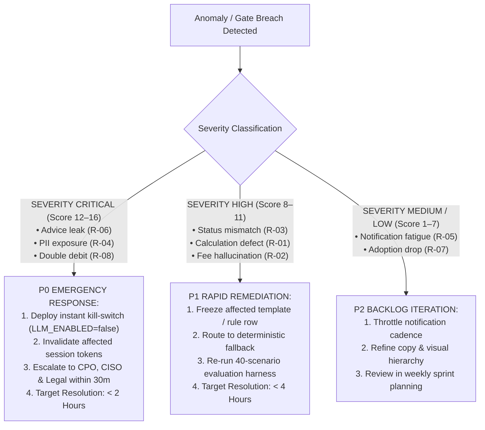

# Risk Register & Mitigation Framework: SIP Steady

**Document Status:** Academic Project Risk Analysis & Governance Framework  
**Version:** 1.0.0 (Pre-Approval Operational Protocol)  
**Target Product:** INDmoney SIP Confidence and Recovery Engine (`SIP Steady`)  
**Product Stage:** Proposed Feature Architecture / Functional Prototype (Not deployed in live production; pending formal INDmoney review)  
**Dependencies:**
- [`docs/gtm-strategy.md`](gtm-strategy.md)
- [`docs/guardrail-metrics.md`](guardrail-metrics.md)
- [`docs/evaluation-framework.md`](evaluation-framework.md)
- [`docs/archive/mvp-original/architecture.md`](archive/mvp-original/architecture.md)

---

## 1. Executive Summary & Governance Preamble

This Risk Register identifies, analyzes, and establishes mitigation strategies for the primary technical, financial, regulatory, and user-experience risks associated with the **SIP Steady** product proposal.

> [!IMPORTANT]
> **Operational Boundary Notice:**  
> This risk register is formulated as a product management graduation project specification. **The product is not yet approved by INDmoney leadership, integrated into live banking rails, or deployed in production.** The mitigation strategies and thresholds herein represent pre-launch governance standards.

---

## 2. Risk Assessment Methodology & Scoring Matrix

Every risk is assessed against standard qualitative likelihood and business/regulatory impact scales:

```
┌────────────────────────────────────────────────────────────────────────────────────────┐
│                              SEVERITY EVALUATION MATRIX                                │
├─────────────────────────┬──────────────────────────────────────────────────────────────┤
│ LIKELIHOOD SCALE        │ IMPACT SCALE                                                 │
├─────────────────────────┼──────────────────────────────────────────────────────────────┤
│ • Rare (1)              │ • Minor (1): Cosmetic UI friction; quick self-serve recovery │
│ • Unlikely (2)          │ • Moderate (2): Non-blocking delay; minor support contact    │
│ • Possible (3)          │ • Major (3): User drop-off; incorrect calculation; churn risk│
│ • Likely (4)            │ • Critical (4): SEBI non-compliance; PII leak; fund loss/fee │
└─────────────────────────┴──────────────────────────────────────────────────────────────┘
```

$$\text{Severity Score} = \text{Likelihood} \times \text{Impact} \quad \longrightarrow \quad \begin{cases} 1 \text{ to } 3: & \textbf{Low} \\ 4 \text{ to } 8: & \textbf{Medium} \\ 9 \text{ to } 12: & \textbf{High} \\ 13 \text{ to } 16: & \textbf{Critical} \end{cases}$$

---

## 3. Master Risk Register

The table below catalogs the eight required risk domains alongside architectural mitigations, operational owners, and monitoring mechanisms:

| Risk ID | Risk Category | Risk Summary | Likelihood | Impact | Severity Score | Assigned Owner | Primary Mitigation Strategy |
|:---:|:---|:---|:---:|:---:|:---:|:---|:---|
| **R-01** | **Incorrect AI Explanations** | Generative LLM produces inaccurate volatility context or hallucinates numbers. | Possible (3) | Major (3) | **High (9)** | AI Engineering Lead | Strict deterministic templates by default; placeholder contract blocking raw digits; instant fallback. |
| **R-02** | **Financial Misinformation** | System asserts unverified fees, false return guarantees, or unvetted market benchmarks. | Unlikely (2) | Critical (4) | **High (8)** | Content Lead & Compliance | Hardcoded AMFI/SEBI source library; Gate `G-FEES` ($0$ invented fees); legal sign-off. |
| **R-03** | **Incorrect Payment Status** | Derived state engine misreports active SIP as cancelled or failed debit as active. | Possible (3) | Critical (4) | **Critical (12)**| Payments PM & Backend Lead | Deterministic state machine derived from settled transaction ledger; nightly bank reconciliation. |
| **R-04** | **Privacy & Security Concerns** | PII (PAN, bank details) or portfolio data leaked to third-party LLMs or client logs. | Unlikely (2) | Critical (4) | **High (8)** | Information Security Officer | Zero PII passed to APIs; client-side JSON sanitizers; masked error logging; token isolation. |
| **R-05** | **Over-Notification & Fatigue** | Pre-debit and restart alerts sent too frequently, causing opt-outs and uninstalls. | Likely (4) | Moderate (2) | **Medium (8)** | Growth / CRM Product Manager | Reminders strictly **opt-in and unchecked by default**; exactly ONE reminder per pause; zero follow-up nags. |
| **R-06** | **User Dependency on AI** | Investors treat Return Coach as an investment oracle, demanding buy/sell/hold tips. | Likely (4) | Major (3) | **Critical (12)**| Head of Regulatory Affairs | Persistent "Not advice" disclaimer; edge pre-filter blocking 100% of advice queries; RIA pointers. |
| **R-07** | **Poor Feature Adoption** | Newcomers miss the Return Coach or Debit Explainer, continuing silent abandonment. | Possible (3) | Major (3) | **High (9)** | Product Design Lead | Contextual in-situ placement directly beneath negative return figures; prominent alert banners. |
| **R-08** | **Integration Limitations** | Bank/NPCI rails return cryptic unmapped codes or reject automated pause API calls. | Likely (4) | Major (3) | **Critical (12)**| Head of Payment Partnerships | Calm generic fallbacks (*"We couldn't debit; SIP active"*); platform-level skip scheduling. |

---

## 4. Deep-Dive Risk Profiles & Mitigation Strategies

---

### R-01: Incorrect AI Explanations & Generative Hallucinations

* **Risk Description:** In the optional generative path (Phase 7), an LLM rephrasing portfolio context could alter numbers, invert volatility direction (e.g. describing a $-2\%$ drop as positive), or provide misleading historical narratives.
* **Likelihood:** Possible (3) | **Impact:** Major (3) | **Severity:** **High (9)**
* **Mitigation Strategy:**
  1. **Deterministic by Default:** The core production product renders strictly from pre-audited, deterministic templates (`mode: TEMPLATE`).
  2. **Placeholder Contract:** Generative rephrasing (`mode: REPHRASE`) operates exclusively through placeholder tokens (`{invested}`, `{current_value}`, `{return_pct}`).
  3. **Zero-Digit Validator:** The output validator (`validator.ts`) rejects any model response containing raw ASCII digits (`0–9`) or spelled-out number words (*"twenty thousand"*, *"ten percent"*).
  4. **Instant Fallback Circuit Breaker:** Any validator rejection silently serves the deterministic template with zero user-facing error.
* **Assigned Owner:** AI Systems Engineering Lead.
* **Monitoring Approach:** Automated CI validator testing (14 seeded negative cases); weekly human audit of 50 randomly sampled rephrased logs; automated alerting if fallback rate exceeds $2.0\%$.

---

### R-02: Financial Misinformation & Unverified Claims

* **Risk Description:** The system states that a fund is "guaranteed to recover", claims an unverified penalty applies (e.g. ₹300 bank bounce charge), or invents market return benchmarks.
* **Likelihood:** Unlikely (2) | **Impact:** Critical (4) | **Severity:** **High (8)**
* **Mitigation Strategy:**
  1. **Source Grounding Gate (`G-GROUND`):** Every general market assertion is tied to a verified `passage_id` in `sources.v1.json` linking to official AMFI, SEBI, or AMC publications.
  2. **Zero Invented Fees Gate (`G-FEES`):** Strict prohibition on mentioning penalties, exit loads, or taxes unless backed by confirmed rule rows.
  3. **Refusal of Guarantees:** Scenario `S-27` enforces strict factual refutation of 3-year profit guarantees, citing statutory mutual fund risk warnings.
* **Assigned Owner:** Financial Content Lead & Legal Counsel.
* **Monitoring Approach:** Build-time linter scanning content against `banned-phrases.ts`; bi-weekly compliance audits of all active source URLs.

---

### R-03: Incorrect Payment Status & Mandate Misclassification

* **Risk Description:** Following a failed instalment, the system incorrectly displays the SIP as `CANCELLED`, causing the user to abandon the investment; or displays an inactive mandate as `ACTIVE`, resulting in surprise failed debits.
* **Likelihood:** Possible (3) | **Impact:** Critical (4) | **Severity:** **Critical (12)**
* **Mitigation Strategy:**
  1. **Derived Status Engine (`src/data/status.ts`):** SIP status is **strictly derived at runtime** from settled transaction records, active pause schedules, and mandate validity. It is never stored as a mutable database flag that can drift.
  2. **Status Nuance:** Failed debits explicitly map to `MISSED_CONTINUES` (mandate remains intact) rather than termination.
  3. **Consecutive Failure Rules:** A SIP is only marked `AT_RISK` if bank-confirmed consecutive failure thresholds are breached.
* **Assigned Owner:** Core Payments PM & Backend Architecture Lead.
* **Monitoring Approach:** Nightly reconciliation batch jobs comparing UI status badges against core banking mandate logs; zero-tolerance automated alert on status discrepancies.

---

### R-04: Privacy Concerns & Information Security Leaks

* **Risk Description:** PII (PAN, phone number, bank account details) or sensitive net-worth figures leak into third-party LLM APIs, client-side analytics logs, or browser cache, violating India's Digital Personal Data Protection (DPDP) Act.
* **Likelihood:** Unlikely (2) | **Impact:** Critical (4) | **Severity:** **High (8)**
* **Mitigation Strategy:**
  1. **Zero PII Payload Architecture:** API calls to Return Coach transmit only integer paise amounts, tenure months, and fund category tokens. Names, PAN, and account numbers are strictly excluded from request contracts.
  2. **Automated Payload Sanitization:** Outbound logging layers redact sensitive keys and apply regex masking to all 10-character PAN and 12-digit account strings.
  3. **No-Store Cache Control:** All financial endpoints return `Cache-Control: no-store` headers.
* **Assigned Owner:** Chief Information Security Officer (CISO) & Platform Architect.
* **Monitoring Approach:** Sentry error log monitoring with active PII filters; quarterly third-party penetration testing and prompt injection audits.

---

### R-05: Over-Notification, Alert Fatigue & User Annoyance

* **Risk Description:** Sending repetitive pre-debit alerts or restart reminders annoys investors, triggering push notification disablement, high app opt-outs, or brand erosion.
* **Likelihood:** Likely (4) | **Impact:** Moderate (2) | **Severity:** **Medium (8)**
* **Mitigation Strategy:**
  1. **Strictly Opt-In:** Restart reminders are **unchecked by default**; notifications are delivered only if the user deliberately toggles the checkbox during pause configuration.
  2. **Exactly One Message:** A pause event triggers **exactly one** notification before the resume date. If dismissed or ignored, **zero follow-up nudges or escalation emails are ever sent**.
  3. **Calm Design Copy:** Messages contain neutral, factual statements (*"Your SIP is scheduled to resume on [Date]"*) with zero countdowns, FOMO, or guilt language.
* **Assigned Owner:** Growth / CRM Product Manager.
* **Monitoring Approach:** Weekly tracking of `notification_opt_out` and unsubscribe rates (must remain $< 1.0\%$); immediate throttling if opt-outs rise above $1.5\%$.

---

### R-06: User Dependency on AI & Perceived Investment Advice

* **Risk Description:** First-time investors misinterpret the Return Coach as an algorithmic robo-advisor and act on perceived recommendations, exposing INDmoney to SEBI regulatory sanctions under the Investment Advisers Regulations.
* **Likelihood:** Likely (4) | **Impact:** Major (3) | **Severity:** **Critical (12)**
* **Mitigation Strategy:**
  1. **Visible Persistent Disclaimers:** Every Return Coach screen prominently features: *"Explains your SIP figures. Not investment advice."*
  2. **Deterministic Advice Refusal Interceptor:** Pre-filters match all buy/sell/switch/hold keywords, serving the fixed refusal card before any generative processing occurs.
  3. **Strict Neutrality on Pause/Cancel:** The options comparison matrix presents *Pause vs Reduce vs Cancel* with equal visual weight, never nudging the user to stay invested.
* **Assigned Owner:** Head of Legal & Regulatory Compliance.
* **Monitoring Approach:** Telemetry monitoring of `sip_coach_refusal_shown` events; tracking user clarity feedback metric `felt_like_advice` (target $< 0.5\%$).

---

### R-07: Poor Feature Adoption & Discoverability

* **Risk Description:** Users experiencing return anxiety or payment failures overlook the in-situ coach or explainer triggers, continuing to leave the app to seek unvetted advice on social media.
* **Likelihood:** Possible (3) | **Impact:** Major (3) | **Severity:** **High (9)**
* **Mitigation Strategy:**
  1. **Zero-Click Ambient Card:** For flat/negative portfolios, the primary reassurance headline renders directly on the SIP card without requiring a click.
  2. **Contextual Action Links:** Failed transactions display an immediate amber action button (*"Why did this fail? Tap for details"*).
  3. **Accessibility & Touch Targets:** All entry triggers adhere to minimum $44 \times 44\text{ px}$ hit targets with WCAG 2.2 AA high-contrast styling.
* **Assigned Owner:** Product Design Lead & Mobile UX Engineer.
* **Monitoring Approach:** Funnel telemetry tracking impressions vs opens (`sip_coach_opened`, `debit_explainer_viewed`); target engagement rate $\ge 30\%$ among exposed negative-return sessions.

---

### R-08: Banking Integration Limitations & Code Opacity

* **Risk Description:** Partner banks emit undocumented UPI Autopay failure codes, payment aggregators delay webhook status by $> 24$ hours, or AMC platforms reject automated pause API calls.
* **Likelihood:** Likely (4) | **Impact:** Major (3) | **Severity:** **Critical (12)**
* **Mitigation Strategy:**
  1. **Graceful Generic Fallback:** Unmapped codes automatically trigger Fallback `F-D1`: *"We couldn't complete this debit. Your SIP remains active"*, providing a direct support action without guessing.
  2. **Platform-Level Pause Scheduling:** If partner AMCs do not support native e-mandate pausing, INDmoney manages the pause at the order-routing layer by skipping scheduled instalment triggers while keeping the underlying mandate active.
  3. **Idempotency Protection:** All retry endpoints require client-generated UUID keys to prevent double-debiting during bank rail latency spikes.
* **Assigned Owner:** Head of Payment Partnerships & Technical Integration Lead.
* **Monitoring Approach:** Real-time API webhook latency dashboards; daily tracking of unmapped error code frequencies in `debit-rules.v1.json`.

---

## 5. Operational Incident Response & Escalation Protocol



---

## 6. Summary of Governance Commitments

1. **Safety Over Growth:** Under no circumstance will INDmoney compromise investor safety, clear disclosure, or SEBI compliance to artificially inflate short-term SIP retention.
2. **Transparent Boundaries:** The product will always openly state its operational boundaries, admitting uncertainty via "Not Sure" states rather than offering speculative answers.
3. **Continuous Auditability:** All risks will be re-evaluated quarterly following the completion of each phased rollout gate.

