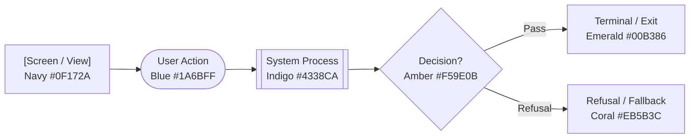
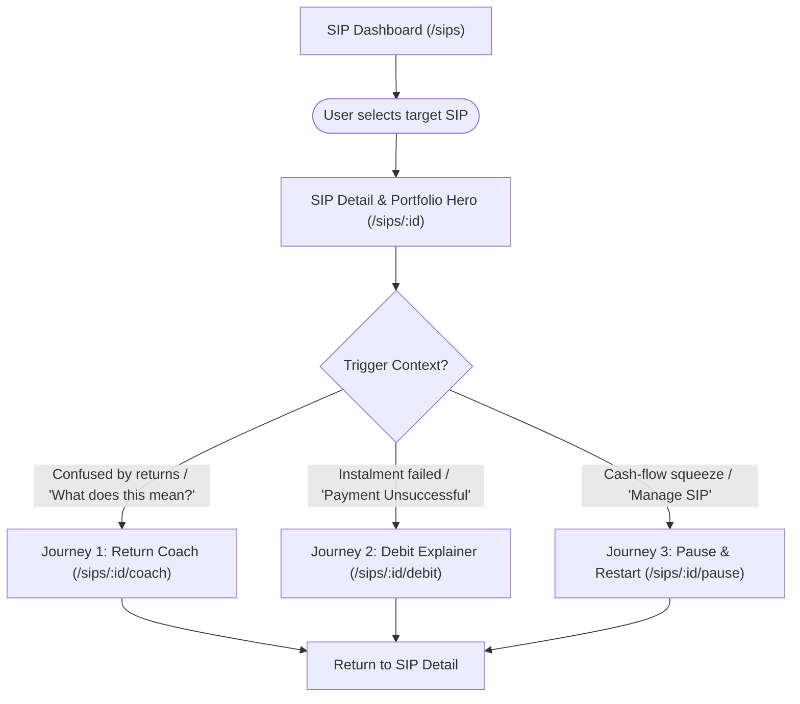
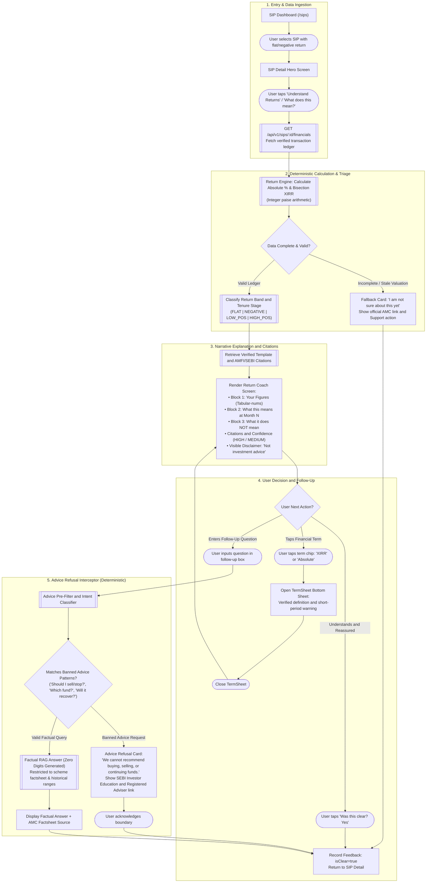
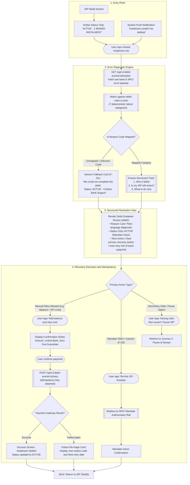
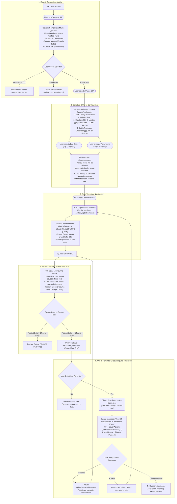

# User Flow & Interaction Specification: SIP Steady

**Document Version:** 2.0.0  
**Status:** Approved for Implementation & Visual Blueprinting  
**Target Platform:** INDmoney Mobile & Responsive Web (Next.js 16.4.5 + React 19)  
**Whimsical Conversion Standard:** Memory Board Node Architecture (Cards, Processes, Decisions, Terminals)  
**Inputs & Dependencies:**
- [`docs/detailed-rice.md`](detailed-rice.md)
- [`docs/archive/mvp-original/architecture.md`](archive/mvp-original/architecture.md)
- [`docs/archive/mvp-original/implementation-plan.md`](archive/mvp-original/implementation-plan.md)
- [`prototype/prototype/clickable/app.js`](../clickable-prototype/clickable/app.js)

---

## 1. Executive Summary & Design Principles

This document defines the formal user flows for the three core modules of the **SIP Steady** retention engine:
1. **Journey 1: Return Coach** — In-situ volatility reassurance and metric contextualization.
2. **Journey 2: Debit Explainer** — Triage and recovery for failed auto-debits and mandate glitches.
3. **Journey 3: Pause and Restart** — Reversible cash-flow flexibility with opt-in, non-urgent reminders.

### Mandatory UX & Regulatory Guardrails

All three user journeys strictly enforce the following behavioral and compliance rules:

```
┌────────────────────────────────────────────────────────────────────────────────────────┐
│                              MANDATORY DESIGN GUARDRAILS                               │
├──────────────────────────────┬──────────────────────────────┬──────────────────────────┤
│ 1. CALM & NON-URGENT         │ 2. STRICT NON-ADVICE         │ 3. DETERMINISTIC CORE    │
│ • No countdown timers        │ • Persistent visible notice: │ • Hardcoded rule tables  │
│ • No streak-loss warnings    │   "Explains figures. Not     │ • Scaled integer math    │
│ • No guilt or FOMO phrasing  │   investment advice."        │ • 0 runtime hallucination│
│ • Coral ONLY for tech errors │ • 100% refusal of buy/sell   │ • Cited AMFI/SEBI sources│
└──────────────────────────────┴──────────────────────────────┴──────────────────────────┘
```

---

## 2. Whimsical Board Conversion & Node Legend

To allow immediate conversion into a visual **Whimsical Memory Board**, all steps and flowchart elements follow a standardized visual and structural taxonomy:

### Node Shape & Color Mapping

| Visual Element | Whimsical Shape | Color Token | Hex Code | Purpose |
|:---|:---|:---|:---:|:---|
| **Screen / View** | Card / Rectangle | Dark Slate / Navy | `#0F172A` / `#1E293B` | A full screen, dashboard view, or modal sheet. |
| **User Action** | Rounded Rectangle / Pill | Royal Blue | `#1A6BFF` / `#2563EB` | A conscious user interaction (tap, scroll, submit). |
| **System Process** | Subroutine / Box | Indigo / Purple | `#4338CA` / `#6366F1` | An automated backend API call, calculation, or query. |
| **Decision Point** | Diamond (Rhombus) | Amber | `#D97706` / `#F59E0B` | A conditional branch based on user choice or data state. |
| **Refusal / Fallback**| Hexagon / Callout | Coral / Rose | `#DC2626` / `#EB5B3C` | Non-advice refusals, error states, or "Not Sure" fallbacks.|
| **Terminal / Exit** | Circle / Oval | Emerald Green | `#059669` / `#00B386` | Successful task completion or return to dashboard. |



---

## 3. High-Level Navigation Architecture

The master navigation connects the global SIP overview with the three dedicated feature modules:



---

## 4. Journey 1: Return Coach (Contextual Volatility Reassurance)

### 4.1 Required Primary Flow Progression
$$\text{SIP Dashboard} \longrightarrow \text{Select SIP} \longrightarrow \text{Understand Returns} \longrightarrow \text{Fetch Verified Financial Data} \longrightarrow \text{Calculate Metrics} \longrightarrow \text{Generate Explanation} \longrightarrow \text{Display Sources and Confidence} \longrightarrow \text{User Understands OR Asks Follow-up}$$

### 4.2 Mermaid Flowchart: Return Coach & Advice Refusal Branch



### 4.3 Detailed Specification: Return Coach

| Attribute | Specification Details |
|:---|:---|
| **Entry Point** | 1. Persistent text link: *"What does this mean?"* adjacent to the return figure on the SIP Detail card.<br>2. Secondary button: *"Is this normal for my stage?"* beneath the Hero valuation.<br>3. Term chip tap on *"XIRR"* or *"Absolute Return"*. |
| **User Action** | The investor taps *"What does this mean?"* on a portfolio showing early flat or negative returns (e.g. Month 5, $-2.1\%$). |
| **System Response** | 1. Displays loading skeleton with zero alarm colors.<br>2. Invokes `GET /api/v1/sips/:id/financials` fetching integer paise ledger.<br>3. Computes exact $A\%$ (Absolute Return) and iterative bisection XIRR.<br>4. Evaluates tenure bracket ($1–3\text{m}$, $3–6\text{m}$, $6–12\text{m}$) and return band (`NEGATIVE`).<br>5. Assembles approved 3-block narrative: *Your Figures*, *What this means*, *What it does NOT mean*.<br>6. Appends verified AMFI citation and confidence badge (`HIGH`).<br>7. Renders persistent compliance disclaimer: *"Explains your SIP figures. Not investment advice."* |
| **Decision Points** | 1. **Data Integrity Check:** Does the SIP have $\ge 2$ settled instalments and a matching valuation timestamp?<br>2. **User Inquiry Type:** Does the user accept the explanation, inspect a term, or submit a follow-up query?<br>3. **Advice Pre-Filter Gate:** Does the user's follow-up question ask for recommendation or future prediction? |
| **Alternative Paths** | 1. **Term Sheet Flow (F3):** User taps "XIRR" chip $\to$ opens accessible bottom sheet containing AMFI definition and short-tenure distortion caveat.<br>2. **Positive Return Stage (F6):** Available on-demand for positive portfolios; displays milestone reinforcement without predictive promises.<br>3. **Factual Query Flow:** User asks *"How is XIRR calculated?"* $\to$ returns verified mathematical formula. |
| **Failure States** | 1. **Insufficient Data (F1):** Tenure $< 1$ month $\to$ displays neutral card: *"Not enough instalments yet to establish performance patterns"*, links to AMFI Guide.<br>2. **Valuation Date Mismatch (RC-E4b):** Stale NAV timestamp $\to$ suppresses calculation, shows *"Portfolio data refreshing from AMC"*, disables Coach.<br>3. **XIRR Divergence (F5):** Bisection math diverges from broker display $> 50\text{ bps}$ $\to$ displays account figure with label *"as shown in account"*, lowers confidence to `MEDIUM`. |
| **Advice-Seeking Refusal Branch** | **Trigger:** User enters *"Should I stop my SIP?"*, *"Will this fund recover?"*, or *"Which fund is better?"*<br>**System Action:** Intercepted by deterministic pre-filter in `banned-phrases.ts` before reaching any model.<br>**Refusal UI:** Renders non-judgmental card: *"INDmoney explains portfolio figures but cannot provide financial advice, fund ratings, or buy/sell recommendations."*<br>**Pointer:** Provides link to SEBI Investor Education portal and directory of registered Investment Advisers (RIAs). |
| **Exit Point** | User taps *"Back to SIP Overview"*, closing the Coach with zero follow-up nudges or unrequested push notifications. |

---

## 5. Journey 2: Debit Explainer (Payment & Mandate Repair)

### 5.1 Required Primary Flow Progression
$$\text{Failed Debit Notification / Row} \longrightarrow \text{Open Debit Explainer} \longrightarrow \text{Evaluate NPCI Reason Code} \longrightarrow \text{Display 3 Structured Answers} \longrightarrow \text{Execute 1-Tap Retry OR Mandate Action} \longrightarrow \text{Confirm Recovery & Update SIP Status}$$

### 5.2 Mermaid Flowchart: Debit Explainer



### 5.3 Detailed Specification: Debit Explainer

| Attribute | Specification Details |
|:---|:---|
| **Entry Point** | 1. Tapping an amber-flagged row in the SIP transaction history (*"Debit Failed — Tap for details"*).<br>2. Tapping the transactional push/in-app alert (*"Your ₹2,500 SIP instalment could not be debited"*). |
| **User Action** | The investor taps the failed transaction to understand why the deduction failed and whether their SIP was cancelled. |
| **System Response** | 1. Queries `debit-rules.v1.json` using the sponsor bank/NPCI error code (e.g., `U30`, `INSUFFICIENT_FUNDS`).<br>2. Maps raw code to one of 7 standardized categories (`BALANCE`, `UPI_LIMIT`, `MANDATE_EXPIRED`, `BANK_DOWNTIME`, `AUTH_FAILED`, `ACCOUNT_BLOCKED`, `TECHNICAL`).<br>3. Displays the three mandatory questions: **Why it failed**, **Is my SIP still active?**, and **What to do next**.<br>4. Reassures user with verified status: mandate remains active; no penalty charge from INDmoney. |
| **Decision Points** | 1. **Manual Retry Eligibility:** Does the bank rail permit immediate on-demand retry, or is it locked to batch auto-retry?<br>2. **Action Routing:** Does the root cause require balance addition, UPI limit reset, or mandate re-authorization?<br>3. **User Continuation:** Does the user initiate immediate recovery, re-authorise mandate, or seek pause options? |
| **Alternative Paths** | 1. **Mandate Re-Linking (F-D3):** If mandate expired or cancelled $\to$ replaces retry button with *"Re-authorise Mandate"*, initiating fresh NPCI UPI handle setup.<br>2. **Daily Limit Exceeded (F-D4):** Reason clarifies UPI app limits $\to$ prompts user to retry using NetBanking or increase limit.<br>3. **Cash-Flow Pivot (F-P10):** Secondary, quiet link beneath retry button: *"Need to pause this month instead?"* $\to$ routes to Journey 3. |
| **Failure States** | 1. **Unmapped Error Code (F-D1):** Bank sends obscure custom code $\to$ system displays calm fallback: *"We couldn't complete this debit. Your SIP remains active"*, provides support contact.<br>2. **Retry Fails Again (RC-E07):** Second attempt rejected $\to$ shows updated diagnostic, indicates scheduled automatic retry date, prevents infinite retry loops.<br>3. **Double-Debit Prevention:** Enforces client-generated `idempotencyKey` on retry button; disables button immediately on first tap. |
| **Exit Point** | Returns to SIP Detail displaying updated status badge (`ACTIVE` on success, or `ACTIVE · NEXT RETRY [DATE]`). |

---

## 6. Journey 3: Pause and Restart (Cash-Flow Flexibility)

### 6.1 Required Primary Flow Progression
$$\text{SIP Detail} \longrightarrow \text{Manage SIP} \longrightarrow \text{3-Way Equal Matrix} \longrightarrow \text{Select Pause} \longrightarrow \text{Set Duration & Opt-In Reminder} \longrightarrow \text{Review Verified Consequences} \longrightarrow \text{Confirm Pause} \longrightarrow \text{State: PAUSED / RESTART_PENDING} \longrightarrow \text{Opt-In Reminder: Resume / Extend / Dismiss}$$

### 6.2 Mermaid Flowchart: Pause and Restart



### 6.3 Detailed Specification: Pause and Restart

| Attribute | Specification Details |
|:---|:---|
| **Entry Point** | 1. Tapping *"Manage SIP"* in the top navigation of the SIP Detail screen.<br>2. Secondary link on the Debit Explainer screen: *"Looking for pause options instead?"* |
| **User Action** | The investor selects *"Pause SIP"* from a 3-way side-by-side comparison matrix (*Pause vs Reduce vs Cancel*). |
| **System Response** | 1. Presents the Pause Configuration form with neutral, factual language.<br>2. Sets default start date to the next upcoming debit date.<br>3. Offers duration presets (1 month, 2 months, 3 months, custom calendar date, or *"Until I resume"*).<br>4. Provides an **opt-in checkbox** for restart reminders (strictly **unchecked by default**).<br>5. Summarizes verified consequences: skipped debits, mandate status, and zero platform fees. |
| **Decision Points** | 1. **Comparison Matrix Choice:** Does the user decide to pause, reduce amount (keeping habit alive), or cancel completely?<br>2. **Duration Structure:** Does the user select a fixed calendar end date or an open-ended pause?<br>3. **Reminder Consent:** Does the user voluntarily check the box to receive an advance reminder? |
| **Alternative Paths** | 1. **Immediate Undo (RC-P04):** Within 24 hours of confirmation, user can tap *"Undo Pause"* $\to$ reverts SIP to `ACTIVE` instantly.<br>2. **Reduce Amount Flow (F-P3):** User selects *"Reduce amount instead"* $\to$ opens slider/input to adjust monthly debit (e.g. ₹2,500 $\to$ ₹1,000) without breaking tenure.<br>3. **Clean Cancellation (F-P4):** User selects *"Cancel"* $\to$ requires single factual confirmation with zero guilt questionnaires, zero retention discounts, and zero friction. |
| **Failure States** | 1. **Past Date Selection:** Date picker rejects any date prior to `today + 2 business days` (mandate processing window).<br>2. **Platform Mandate Incompatibility (F-P2):** If user's sponsor bank does not support automated pause $\to$ UI explicitly explains that upcoming debits will be skipped at AMC level while mandate stays active.<br>3. **Illegal Action Guard (F-P5):** Rejects attempt to pause an already cancelled SIP or resume an active SIP with clean error messaging. |
| **Lifecycle & Reminder Mechanics** | 1. **Derived Status `RESTART_PENDING`:** When an active pause enters $\le 14$ calendar days before its scheduled resume date, status chip dynamically switches from `PAUSED` (Blue) to `RESTART_PENDING` (Amber/Blue).<br>2. **One-Time Reminder Rule:** If opted in, sends **exactly one** factual message: *"Your SIP is scheduled to resume on [Date]"* offering 3 equal actions: `Resume`, `Extend`, `Leave Paused`.<br>3. **Zero-Nag Rule:** If the reminder is ignored or dismissed, **no second reminder, push notification, or escalation email is ever triggered**. |
| **Exit Point** | Returns to SIP Detail displaying active pause dates and clear, accessible *"Resume Now"* / *"Change Dates"* buttons. |

---

## 7. Implemented Features vs. Hypothetical / Deferred Interactions

To maintain strict engineering fidelity and avoid mixing production reality with speculative roadmap concepts, the table below provides an explicit boundary audit:

```
┌────────────────────────────────────────────────────────────────────────────────────────┐
│                              SCOPE & IMPLEMENTATION AUDIT                              │
├────────────────────────────────────────┬───────────────────────────────────────────────┤
│ IMPLEMENTED IN CODE & PROTOTYPE        │ HYPOTHETICAL / DEFERRED TO FUTURE PHASES      │
├────────────────────────────────────────┼───────────────────────────────────────────────┤
│ • Deterministic Integer/BigInt Math    │ • Free-form, unconstrained generative chat    │
│ • Bisection XIRR Solver (Decimal.js)   │ • Real-time bank balance scraping via AA      │
│ • 4 Return Bands (FLAT, NEG, POS, HIGH)│ • Automated predictive cash-flow rescheduling │
│ • 3-Block Approved Narrative Templates │ • Dynamic AI generation of financial figures  │
│ • AMFI/SEBI Verified Citation Engine   │ • Bank fee prediction without verified API    │
│ • Deterministic Advice Refusal Filter  │ • Conversational debit troubleshooting chatbot│
│ • 7-Category Debit Rules Table         │ • Multi-turn conversational memory store      │
│ • Idempotent 1-Tap Debit Retry Flow    │ • Push notification marketing campaigns       │
│ • 3-Way Matrix (Pause/Reduce/Cancel)   │ • Streak gamification or social badges        │
│ • <=14d RESTART_PENDING State Machine  │ • Dark-pattern retention cancel questionnaires│
└────────────────────────────────────────┴───────────────────────────────────────────────┘
```

---

## 8. Whimsical Board Setup & Step-by-Step Translation Guide

For product managers, UX designers, or engineers converting this specification into a visual **Whimsical Diagram**, follow these layout instructions:

### Layout Coordinates & Board Architecture

```
┌────────────────────────────────────────────────────────────────────────────────────────────────┐
│ WHIMSICAL CANVAS WORKSPACE                                                                     │
│                                                                                                │
│  [BOARD 1: RETURN COACH]            [BOARD 2: DEBIT EXPLAINER]        [BOARD 3: PAUSE & RESTART]│
│  (X: 0 to 800, Y: 0 to 1200)        (X: 900 to 1700, Y: 0 to 1200)    (X: 1800 to 2600, Y: 0)  │
│                                                                                                │
│  Row 1: Entry & Triggers            Row 1: Failure Triggers           Row 1: Manage Trigger    │
│  Row 2: Ingestion & Math Engine     Row 2: 7-Rule Evaluation          Row 2: 3-Way Matrix      │
│  Row 3: Explanation Cards           Row 3: Triad UI Display           Row 3: Schedule & Opt-In │
│  Row 4: Advice Refusal Branch       Row 4: Idempotent Retry Rail      Row 4: State Machine     │
│  Row 5: Terminals & Feedback        Row 5: Recovery Confirmation      Row 5: 1-Time Reminder   │
└────────────────────────────────────────────────────────────────────────────────────────────────┘
```

### Conversion Step-by-Step

1. **Step 1: Set Canvas Theme to Dark / High Contrast:**
   - Background canvas: `#0B0E14` or dark gray.
   - Screen cards: `#151A23` with 1px border `#262F40`.
2. **Step 2: Add Entry Points:**
   - Create Navy Cards for `SIP Dashboard` and `SIP Detail`.
   - Connect using standard directional arrows with labeled trigger text.
3. **Step 3: Plot Decision Diamonds for System Gates:**
   - Use Amber Diamonds for `Data Complete?`, `Code Mapped?`, and `Banned Advice?`.
   - Route `Yes` along the primary straight path; route `No` / `Refusal` to the right-hand branch.
4. **Step 4: Style the Refusal and Fallback Nodes:**
   - Use Coral Cards (`#EB5B3C`) for the Advice Refusal card and "Not Sure" fallbacks.
   - Explicitly label them with the compliance disclaimer text.
5. **Step 5: Connect Terminals:**
   - Terminate every journey in an Emerald Oval (`#00B386`) representing safe return to the `SIP Detail` dashboard.
